# Tellal

**A voice for your T3 Code agents.**

The Ottoman *tellal* was the town crier who walked the streets announcing the news out loud (English readers also see "tell-all").

Tellal is a small always-on-top macOS panel that lists your [T3 Code](https://github.com/pingdotgg/t3code) agent threads and reads them aloud with a local voice, so you can follow several agents without watching them.

## Install

1. Download `Tellal-0.4.0.dmg` from the [latest release](https://github.com/cengizhankose/tellal/releases/latest) and drag **Tellal** to Applications. The app is signed with a Developer ID and notarized by Apple.
2. Open it. Tellal is a floating panel with no Dock icon; the global shortcut ⌃⌥Space shows and hides it.
3. On first run it downloads the voice for your language (35 MB Turkish, 96 MB English) into `~/Library/Application Support/tellal/models`. The row above the status line shows the progress.

Needs a Mac with Apple Silicon and macOS 13.4 or newer, and [T3 Code](https://github.com/pingdotgg/t3code) with its `t3` CLI. Optional: [Wispr Flow](https://wisprflow.ai) for voice replies, [cua-driver](https://github.com/trycua/cua) for computer use. To build it yourself, see [Build from source](#build-from-source).

## What it does

Each clip is 6–20 s of the real panel running on demo data ([`demo/fixture.json`](demo/fixture.json)), in English with the English voice and captions (the [Turkish README](README.tr.md) shows the Turkish set). GIFs are silent; the links play with sound.

| | |
|---|---|
| 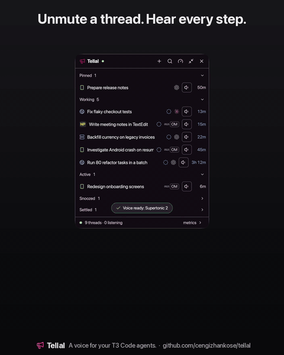 | **Listen to a thread.** Unmute it like a radio channel: one catch-up sentence, then one sentence per step while the agent works. [▶ With sound](docs/media/en/clips/listen.mp4) |
| 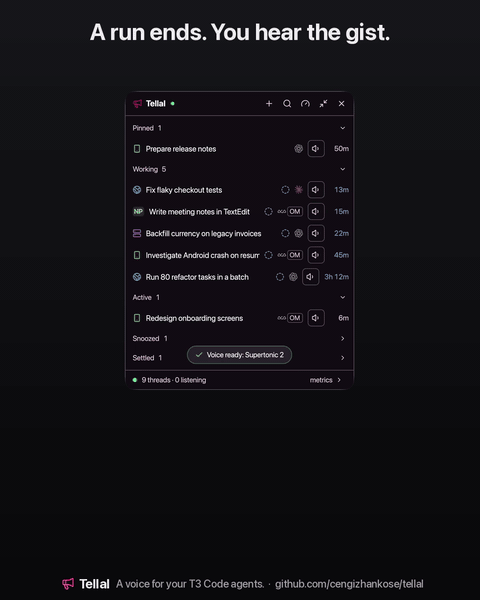 | **Hear the outcome.** When a run ends you hear its one-sentence 🔊 summary ("Of the 80 tasks, 20 got stuck, 30 failed… Shall we start with the errors?"); the full report stays in T3. [▶ With sound](docs/media/en/clips/summary.mp4) |
| 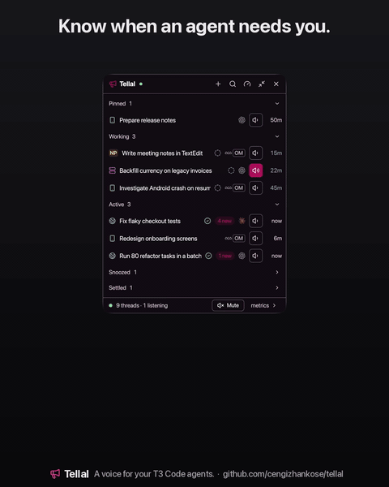 | **Know when an agent needs you.** A thread waiting for an answer or approval raises the attention card; one click jumps to it. [▶ With sound](docs/media/en/clips/attention.mp4) |
| 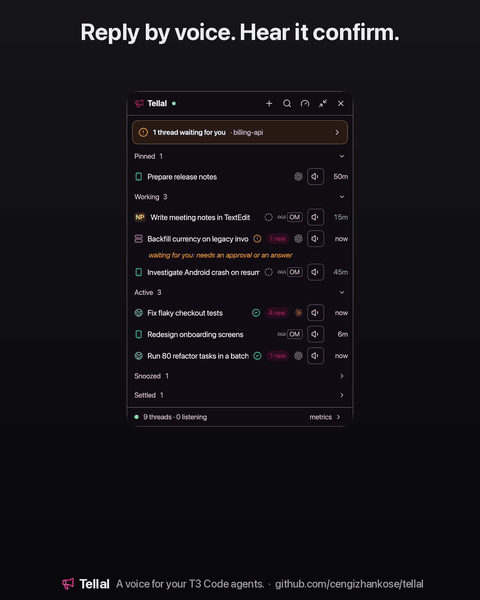 | **Reply by voice.** `Reply` starts [Wispr Flow](https://wisprflow.ai) dictation, `Send` passes it to the thread with `t3 thread send`, and the agent's answer is read out. [▶ With sound](docs/media/en/clips/reply.mp4) |
| 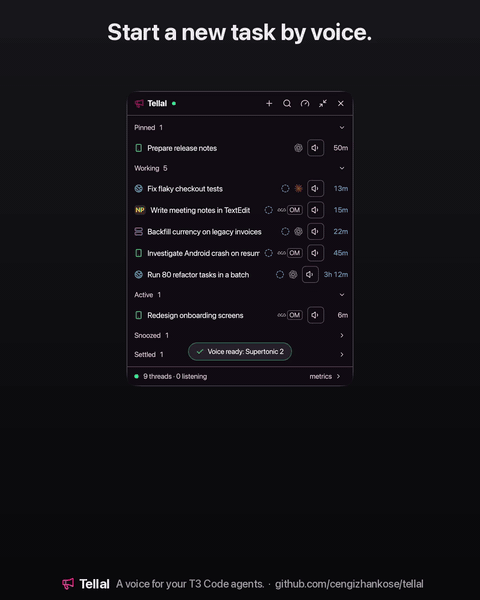 | **Start a task by voice.** `+` (or N), dictate, `Send`: a new T3 thread starts (`t3 thread start`) and the panel is already listening to it. [▶ With sound](docs/media/en/clips/new-task.mp4) |
| 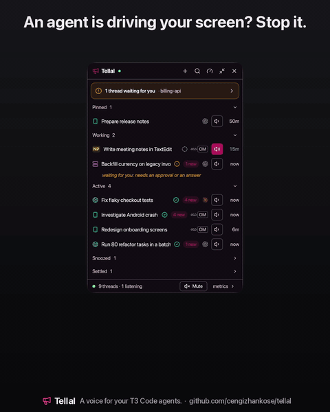 | **See and stop computer use.** While an agent drives the screen through [cua-driver](https://github.com/trycua/cua), a banner says so, with the client and how long ago it last acted (cua-driver reports no app or action); `Stop`, or ⌃⌥⎋ from any app, ends every session. [▶ With sound](docs/media/en/clips/computer.mp4) |
| 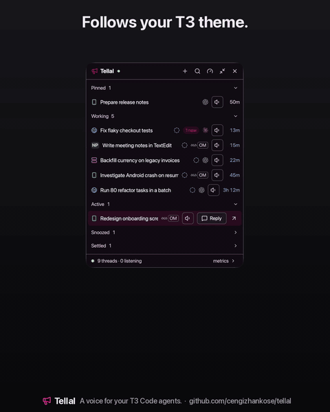 | **Looks like T3.** Colours and font follow the theme picked in T3, light or dark, live. [▶ With sound](docs/media/en/clips/theme.mp4) |

[Full walkthrough with sound (16:9, ~70 s)](docs/media/en/demo.mp4) · [45 s cut for social (4:5)](docs/media/en/tellal-social.mp4). macOS on Apple Silicon only (see [Install](#install)).

<details>
<summary>Screenshots</summary>

| Dark | Light |
|---|---|
| 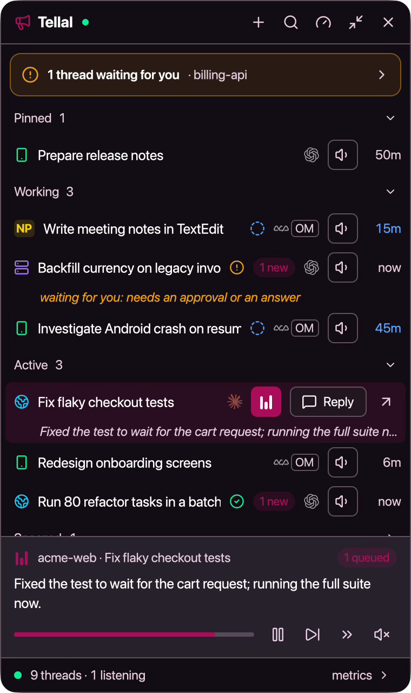 | 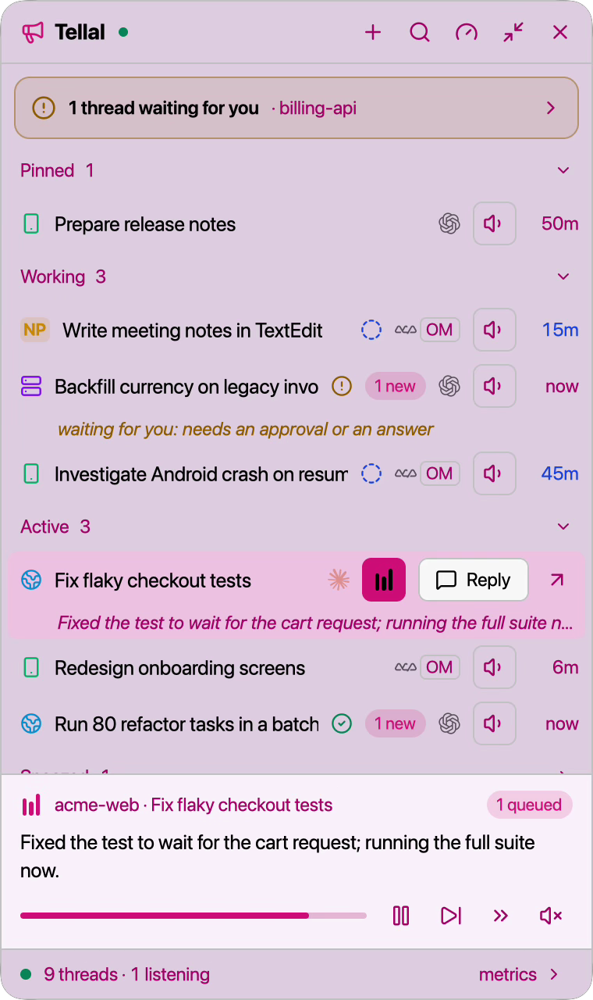 |

| Now playing | Reply dock | Metrics drawer | Compact |
|---|---|---|---|
| 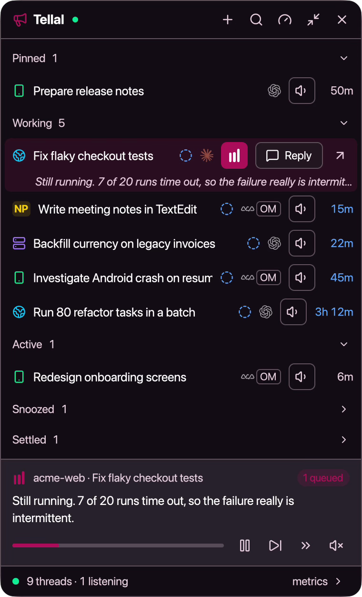 | 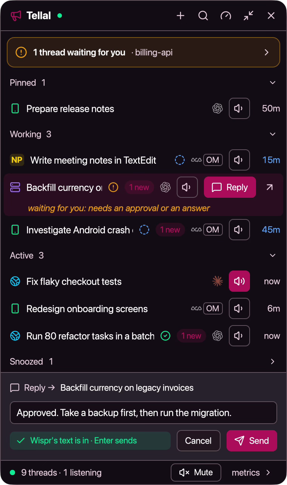 | 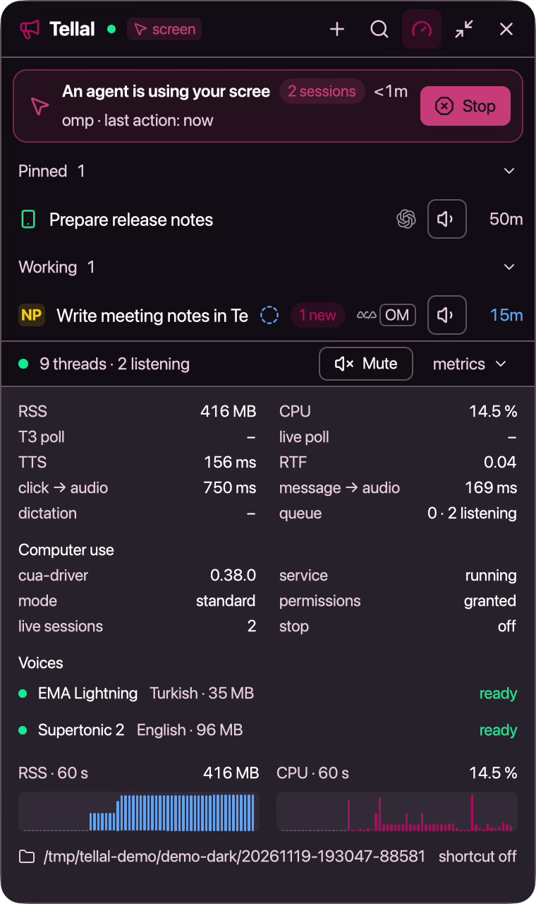 | 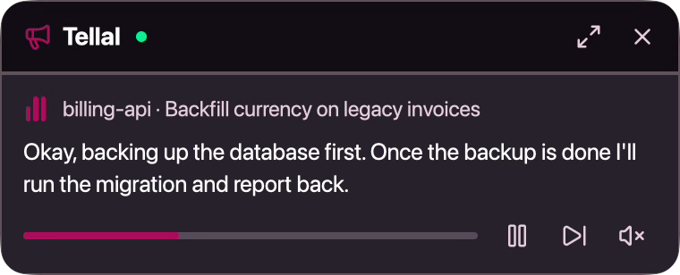 |

| Computer use | Computer-use permissions | New task by voice |
|---|---|---|
| 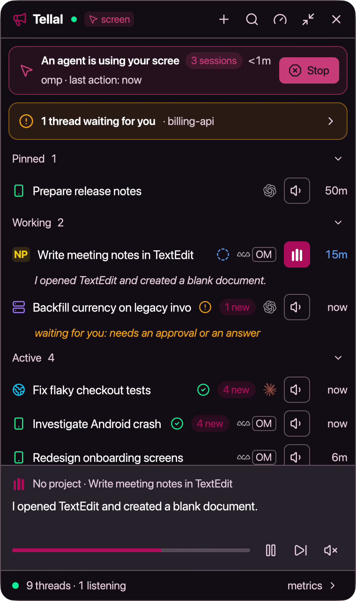 | 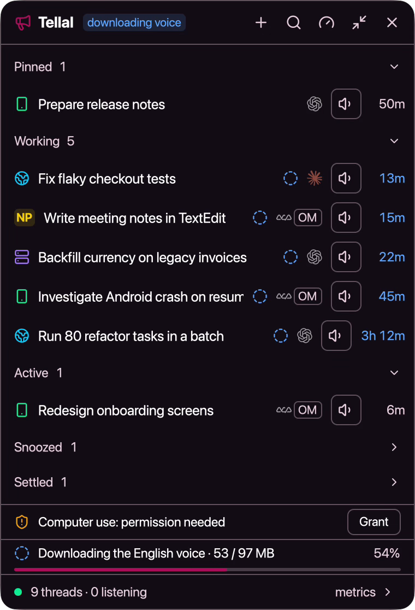 | 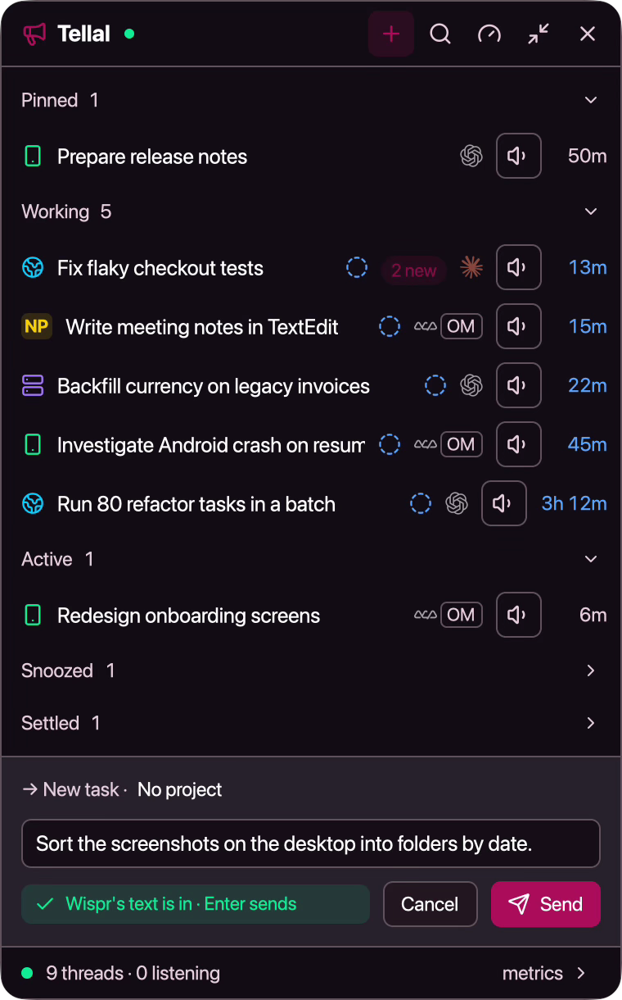 |

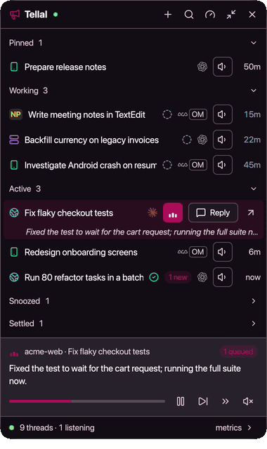

</details>

## Why

I run several coding agents at once. Switching windows to check on each one breaks focus; a voice that says "tests are running", then "11 of 12 pass, shall I fix the last one?" does not. So:

- **Voice first.** Turn a thread on like a radio channel and it tells you what the agent is doing, then a one- or two-sentence summary when it is done. Reply by voice without leaving what you are doing.
- **Agent narration is written for the ear.** The [`sesli`](skill/sesli/) (Turkish) and [`aloud`](skill/aloud/) (English) skills make agents write a short start line, one sentence per step and a `🔊` summary line.
- **Zero API cost, everything local.** The voices are small models (8.6M parameters for Turkish, Supertonic 2 for English) running on the CPU inside the app. No cloud TTS, no account, no per-use cost; each voice is downloaded once.
- **Read-only towards T3.** The panel reads T3's CLI output and state; the only thing it writes is a reply you send.

## Features

- **Radio channels with video controls.** Each thread is a channel with a 🔈/🔊 listen toggle. One voice at a time, first come first served across channels. Pause mid-sentence (the queue keeps filling), skip ("okay, next"), jump to live, mute all.
- **Live narration.** Every new assistant message on a listened channel is spoken: its `🔊` line if it has one, otherwise its first sentence. "Waiting for your answer" and "Stopped" are announced too.
- **Catch-up.** Turning a channel on first reads one catch-up sentence (the last `🔊` line, else the last message's first sentence, else the status). Muted channels count unheard messages (`3 yeni`).
- **🔊 summaries.** The final message's `🔊` line is what you hear; the full written report stays in T3.
- **Attention card.** "N threads are waiting for you" at the top; click to jump to the next one.
- **Reply dock with Wispr Flow.** `Cevapla` (Reply) opens a dock, starts [Wispr Flow](https://wisprflow.ai) hands-free dictation and sends the text to the thread with `t3 thread send` (a busy thread gets it as its next turn). Typing works too.
- **Computer use, with an emergency stop.** When agents drive the screen through the local [cua-driver](https://github.com/trycua/cua) (any MCP client: omp in T3, Claude Code, Codex), a banner at the top says "an agent is using your screen" with the client and when it last acted (`omp · son işlem 2dk`, or `bağlı` before any action; cua-driver reports no app or action), the elapsed time and the session count, plus a red `Durdur` (Stop) that revokes every session at once. ⌃⌥⎋ does the same from any app (⌘. inside the panel). A header pill `ekran` stays while any session is live, also in compact mode. Missing permissions show a slim `İzin ver` (Grant) row; the metrics drawer shows install, daemon, mode, permission and session state.
- **New task by voice.** `+` (or N) opens the dock in new-task mode: dictate with Wispr Flow (or type), `Gönder` starts a new T3 thread with `t3 thread start`, and the panel selects it and is already listening to it.
- **Open in T3.** Double-click a row (or `↗`, ⌘O) to open the thread in the T3 desktop app through its `t3code://` deep link.
- **T3 theme sync.** Colours and font follow the theme selected in T3 (built-in, custom and environment themes, light/dark/system, T3's contrast setting), live, with a 200 ms cross-fade. Contrast floors (text ≥ 7:1, secondary ≥ 4.5:1) are enforced.
- **Stable, T3-parity list.** T3's sections (Pinned, Working, Active, Snoozed, Settled), T3's project icons and provider marks, T3's working timer. Activity never reorders rows.
- **Keyboard first.** ↑/↓, Space (listen), Enter/R (reply), N (new task), ⌘O, P, →, L, M, ⌘K search, ⌘⇧C compact, ⌘. (stop computer use), I (grant computer-use permissions), D (download the missing voice), Esc. Global ⌃⌥Space shows or hides the panel and global ⌃⌥⎋ stops every computer-use session, from any app.
- **Metrics drawer.** RSS, CPU (with 60 s sparklines), T3 poll cost, TTS time, RTF, click→audio, message→audio, dictation latency, queue length, and the computer-use state (cua-driver version or "not installed", daemon, mode, permissions, live sessions, stop shortcut).
- **Full telemetry.** Every input and output is a line in `events.jsonl`; resource samples go to `metrics.jsonl`; every utterance is saved as WAV; `tellal-report` turns a run into p50/p95 tables and an HTML report.
- **Demo mode.** `TELLAL_DEMO=demo/fixture.json` runs the whole panel on scripted fake threads: no T3 threads, no Wispr. Only the T3 theme is read, and the fixture can turn that off.

The UI is in English or Turkish (see [Languages and voices](#languages-and-voices)). Design spec and rationale: [`docs/DESIGN.md`](docs/DESIGN.md).

## Languages and voices

- **UI language.** English or Turkish, set with `TELLAL_LANG=en|tr`; unset, it follows macOS's preferred language (Turkish if it starts with `tr`, otherwise English). It switches every visible string and the lines the panel speaks itself (catch-up and status lines). English copy uses T3's own shelf names (Pinned, Working, Active, Snoozed, Settled) and times (`now`, `5m`, `3h`, `2d`).
- **Voices.** Both can be installed side by side:

  | Id | Language | Model | Licence | Download |
  |---|---|---|---|---|
  | `tr-ema-lightning` | Turkish | [EMA Lightning](https://huggingface.co/canberkkkkkk/ema-lightning) ([ONNX export](https://huggingface.co/ozcancelik/ema-lightning-onnx)) | [Apache-2.0](https://huggingface.co/ozcancelik/ema-lightning-onnx) | 35 MB |
  | `en-supertonic-2` | English | [Supertonic 2](https://huggingface.co/Supertone/supertonic-2), voice M1 (int8 parts from [sherpa-onnx](https://huggingface.co/csukuangfj2/sherpa-onnx-supertonic-tts-int8-2026-03-06)) | [OpenRAIL-M](https://huggingface.co/Supertone/supertonic-2/blob/main/LICENSE) (use restrictions apply, see [`THIRD_PARTY_NOTICES.md`](THIRD_PARTY_NOTICES.md)) | 96 MB |

  Files come from pinned Hugging Face revisions, are checked against SHA-256 sums and land in `TELLAL_MODELS_DIR` (default `~/Library/Application Support/tellal/models`).
- **Which voice speaks.** `TELLAL_VOICE=auto` (default) picks the voice per utterance from its language, so a Turkish thread is read in Turkish and an English one in English when both voices are installed; `tr` or `en` always uses that voice.
- **Downloads.** The UI language's voice downloads itself at first run. While the voice the panel needs is missing, downloading or failed, a row above the status line offers `Download voice`, shows progress or `Retry`; `D` does the same. The metrics drawer has a Voices list with every voice and its state, where the other voice can be downloaded too.
- **Agent skills.** [`aloud`](skill/aloud/) (English, trigger `$aloud`) and [`sesli`](skill/sesli/) (Turkish, trigger `$sesli`) teach agents to write for the ear. Install: [`skill/aloud/README.md`](skill/aloud/README.md), [`skill/sesli/README.md`](skill/sesli/README.md). Replies sent from the panel start with `$aloud ` (English UI) or `$sesli ` (Turkish UI) to keep the skill on (`TELLAL_REPLY_PREFIX`).

## How it works

```
 T3 Code desktop app                                 Wispr Flow (optional)
   ├─ t3 CLI ── thread list / thread send              └─ history DB (read-only)
   ├─ state DB (SQLite, read-only) ── changes, messages,          │
   │                                  waiting requests            │
   └─ theme (localStorage + app.asar, read-only)                  │
                 │                                                │
                 ▼                                                ▼
 tellal-core (Rust)
   poll every 5 s · live tail every 1 s · channels + FIFO queue · theme resolver · telemetry
                 │
                 ▼
   lexicon → normalizer (tr / en) → EMA Lightning (tr, 48 kHz) or Supertonic 2 (en, 44.1 kHz) on ONNX Runtime, CPU → rodio
                 │
                 ▼
 Tellal app: GPUI window in a non-activating NSPanel (always on top, every Space)
```

- **Two crates.** [`crates/core`](crates/core) (`tellal-core`) has no UI: T3 data, channels, voice, telemetry, behind a small API (`Core::threads()`, `channels()`, `set_listening`, `send_reply`, `theme()`, …). [`crates/app`](crates/app) is the GPUI panel.
- **Data.** Thread lists come from T3's official CLI. A single read-only `sqlite3 -readonly` query per tick finds which projects changed, so the CLI runs only for those; another per second fetches new finished assistant messages and waiting approvals/questions for listed threads. T3 integration currently polls the CLI and the read-only state DB; a push-based `t3 thread watch --json` is [proposed upstream](https://github.com/pingdotgg/t3code/discussions/31947#discussioncomment-19752998).
- **Voice.** Two ONNX voices ported to Rust. Turkish: EMA Lightning, Turkish normalization (numbers, times, abbreviations) → the model's alphabet → `text.onnx` → `sound.onnx` (4 steps) → `decoder.onnx`; a pronunciation lexicon respells common English tech words ("pull request", "deploy", "PR") for it. English: Supertonic 2, English normalization (URLs and hashes dropped, numbers, times, units written out) → characters → duration predictor → text encoder → 8 flow-matching steps → vocoder, with its own lexicon. Synthesis runs just in time; the next utterance is prepared while the current one plays.
- **Window.** GPUI's `PopUp` window kind is a non-activating `NSPanel`: it floats above every app and Space without stealing focus, and takes the keyboard only for the reply dock or the global shortcut.

## Build from source

Requirements:

- macOS 13.4+ on Apple Silicon
- [T3 Code](https://github.com/pingdotgg/t3code) desktop app with its `t3` CLI (default `~/.t3/bin/t3`)
- Rust 1.92 or newer
- Optional: [Wispr Flow](https://wisprflow.ai) for voice replies

```bash
git clone https://github.com/cengizhankose/tellal
cd tellal
./scripts/fetch-models.sh [tr|en|all]   # voices (default all: 35 MB + 96 MB) → ~/Library/Application Support/tellal/models; the app can also download them itself
cargo build --release --workspace
target/release/tellal
```

The panel appears top-right above every app. Click 🔈 on a thread to listen; ⌃⌥Space hides and shows it.

**Try it without T3** (no T3 threads or Wispr needed; a voice is still required):

```bash
TELLAL_DEMO=demo/fixture.json target/release/tellal
```

The fixture has 9 threads in 4 projects (Claude, Codex, omp and Cursor; pinned, running, waiting, finished, snoozed, settled). Between about 6 s and 75 s after start they play a script: progress messages, status changes, `🔊` summaries (one is a batch of 80 tasks) and a request for approval. Turn a channel on to hear it. `Cevapla` fills in the fixture's dictation after ~2.5 s, and sending is only logged. The scripted agent answers ~1.5 s later and the thread completes. Opening in T3 is only logged too. Demo mode never runs the `t3` CLI, never reads T3's state DB or Wispr Flow and never opens a URL (`tellal-report` on a demo run shows 0 `t3` and 0 `sqlite3` calls). It still reads your T3 theme, read-only, unless the fixture sets `"theme": "default"`.

Write your own scenario by editing [`demo/fixture.json`](demo/fixture.json): `at_s` is seconds after start, and `en` is an optional English caption. Set `"theme": "default"` to use the built-in dark palette instead of your T3 theme. The optional `computer` block fakes cua-driver (installed, permissions, mode) and scripts computer-use sessions (`{at_s, session, client, app, action, end}`; each later entry of a session is an action at that time). The shipped one is shaped like the real cua-driver (client `omp`, no app or action label) with three sessions while the notes agent works in TextEdit; granting permissions succeeds after ~1.5 s and stopping ends every session at once. The optional `new_task` block is what a voice task creates (`dictation`, `title`, `project`, `provider`, `ack`, `steps[{after_s, text, en, status}]`). To check it headless: `TELLAL_DEMO=demo/fixture.json TELLAL_OUTPUT_VOLUME=0 target/release/tellal-bench --e2e` (or `--computer` for computer use and a new task).

**Agent side.** Install the [`aloud`](skill/aloud/) (English) or [`sesli`](skill/sesli/) (Turkish) skill in Claude Code, Codex or omp so agents write a start line, short step messages and a `🔊` summary. Replies sent from the panel start with `$aloud ` or `$sesli ` (by UI language) to keep it on.

**Maintainers.** `scripts/package-macos.sh <version>` builds, signs, notarizes and staples `Tellal.app` and the DMG; requirements and options are in the script's header.

## Configuration

All settings are environment variables.

| Variable | Default | Meaning |
|---|---|---|
| `TELLAL_DEMO` | — | Path to a demo fixture (e.g. `demo/fixture.json`). Threads, messages, status changes and replies come from the fixture; the T3 CLI, T3's state DB and Wispr's DB are never touched. The T3 theme is still read unless the fixture sets `"theme": "default"`. |
| `TELLAL_OUTPUT_VOLUME` | `1.0` | Playback volume, `0.0`–`1.0`. Synthesis, timing and WAV saving are unchanged (`0` = silent runs and recordings). |
| `TELLAL_T3_BIN` | `~/.t3/bin/t3` | T3 CLI |
| `TELLAL_PROJECTS` | discovered from T3's state DB | Project ids or paths to watch, comma-separated |
| `TELLAL_POLL_MS` | `5000` | Thread list poll interval |
| `TELLAL_LIVE_POLL_MS` | `1000` | Live tail interval (new messages and waiting requests of listed threads) |
| `TELLAL_LANG` | macOS preferred language (`tr*` → `tr`, else `en`) | UI language and the panel's own spoken lines: `en` or `tr` |
| `TELLAL_VOICE` | `auto` | Which voice speaks: `auto` (per utterance, by its language), `tr` or `en` |
| `TELLAL_MODELS_DIR` | `~/Library/Application Support/tellal/models` | Voice models, one directory per voice (`ema-lightning-onnx/`, `supertonic-2-en/`) |
| `TELLAL_TTS_THREADS` | `2` | ONNX Runtime threads for the voice |
| `TELLAL_LEXICON` | `~/Library/Application Support/tellal/lexicon.tsv` | Your pronunciation lexicon for the Turkish voice: `written<TAB>spoken` per line; a key ending in `*` also matches inflected forms. Overrides built-in entries. |
| `TELLAL_LEXICON_EN` | `~/Library/Application Support/tellal/lexicon-en.tsv` | Same, for the English voice |
| `TELLAL_REPLY_PREFIX` | `$sesli ` (Turkish UI) / `$aloud ` (English UI) | Prepended to every reply sent from the panel (empty disables) |
| `TELLAL_CUA_DRIVER` | `/Applications/CuaDriver.app/Contents/MacOS/cua-driver` | cua-driver binary for computer use. Missing = computer use unavailable. The panel watches the daemon socket (`~/Library/Caches/cua-driver/cua-driver.sock`: sessions every 1 s while it runs, 5 s otherwise; permissions every 60 s) and stops sessions with `cua-driver revoke --all` |
| `TELLAL_TASK_PROJECT` | T3's "No project" (`~/.t3/scratch`) | T3 project id or path for tasks started from the panel (`t3 thread start`, provider/model of the newest listed thread) |
| `TELLAL_HOTKEY` | `ctrl+alt+space` | Global show/hide shortcut (`global-hotkey` syntax, e.g. `cmd+shift+KeyP`); `off` disables |
| `TELLAL_STOP_HOTKEY` | `ctrl+alt+escape` | Global computer-use emergency stop (⌃⌥⎋; `cua-driver revoke --all` from any app); same syntax; `off` disables. Registration and presses are logged as `ui.stop_hotkey` |
| `TELLAL_LOG_ROOT` | `~/Library/Logs/tellal` | Telemetry root |
| `TELLAL_SAVE_AUDIO` | `1` | Save every utterance as WAV (`0` disables) |
| `TELLAL_WISPR_DB` | `~/Library/Application Support/Wispr Flow/flow.sqlite` | Wispr Flow history (read-only) |
| `TELLAL_T3_APP` | newest `T3 Code (Nightly).app` / `T3 Code.app` in `/Applications` or `~/Applications` | T3 app bundle whose built-in theme palettes are read |
| `TELLAL_T3_APP_DATA` | `~/Library/Application Support/t3code-v2` | T3's Electron userData dir (selected theme; read-only) |
| `TELLAL_SELFTEST` | — | Scripted UI runs that log and exit: `1` (listen to the first finished thread, then quit), `reply:<thread_id>` (reply flow; `TELLAL_SELFTEST_STOP_AFTER_MS`, `TELLAL_SELFTEST_NOSEND=1`), `shots` (step through UI states: full, voice_downloading, voice_failed, voice_ready, permissions, selected, dock, drawer, computer, compact, empty_search, error, new_task; the voice states walk the voice row's download and are skipped when no voice row can appear; the computer-use states wait for the demo fixture's sessions; `TELLAL_SELFTEST_STEP_MS`), `demo` (timed walkthrough on demo data, used to record the demo media; includes granting permissions, the computer-use banner with one `Durdur`, and a new task), `clip:<name>[:<thread>]` (one feature on demo data for the README clips: `listen`, `summary`, `attention`, `reply`, `new-task`, `computer`, `theme`; `<thread>` is the thread it selects or tunes in to; see [`tools/`](tools/README.md)). Scripted demo and clip runs ignore the mouse. |

## Telemetry

Each run writes to `~/Library/Logs/tellal/<YYYYMMDD-HHMMSS-pid>/` (`latest` points to the newest). Nothing leaves the machine.

- `events.jsonl`: one line per input or output, `{ts, run, seq, kind, dur_ms, ok, in, out, err}`. T3 calls (`t3.*`, with argv, duration, child CPU and RSS), live tail (`live.*`), channel actions (`channel.*`), speech (`speak.enqueue`, `tts.synth` with written / respelled / spoken text and RTF, `audio.play` with click→audio and message→audio), replies and dictation (`reply.*`, `wispr.history`), new tasks (`task.start`: argv, text, exit, stdout JSON), computer use (`computer.poll` with method, duration and child CPU; `computer.session_start` / `computer.action` / `computer.session_end`; `computer.stop` with sessions revoked; `computer.permissions_grant`), theme resolution (`theme.resolve`, contrast ratios) and every UI interaction (`ui.*`, with before/after state).
- `metrics.jsonl`: RSS, CPU, thread count, queue length and child CPU, once per second.
- `audio/<seq>.wav`: every spoken utterance.

```bash
target/release/tellal-report latest   # per-kind p50/p95/max, RSS/CPU, poll cost, latencies → report.json + report.html
target/release/tellal-bench           # voice: cold load, per-sentence synth ms and RTF, peak RSS (Turkish)
target/release/tellal-bench --voice en   # same, English voice and English agent lines
target/release/tellal-bench --corpus sentences.txt   # same, with your sentences (one per line)
target/release/tellal-bench --download [ID ...]   # download voices (default all) into TELLAL_MODELS_DIR, checksums verified
target/release/tellal-bench --t3      # cost of listing every project, 3 rounds
target/release/tellal-bench --theme   # resolve the T3 theme once: ThemeView JSON, contrast table
target/release/tellal-bench --e2e     # headless end-to-end: list, listen, progress, pause/resume
target/release/tellal-bench --computer [--stop-on-session]   # headless: print Core::computer() on every change, CPU% over 60 s (demo: also grant, new task, stop all)
```

## Numbers

Measured on an Apple M4 Pro (macOS 27, other apps open).

| What | Result |
|---|---|
| Voice selection | Turkish: 21 open Turkish-capable models surveyed; [bake-off](research/tts/bakeoff.md) of 59 runs (engines × voices × settings) on 7 panel sentences, scored by Whisper read-back. English: [survey](research/tts/english.md) |
| Voice cold load | ~0.6 s (Turkish) |
| Synthesis | 30–250 ms per sentence, RTF ~0.04 |
| Memory (RSS) | ~150–200 MB while speaking (CoreML was ~700 MB; the CPU provider is used) |
| Click → first audio | ~250 ms (247 ms measured) |
| Idle CPU | ~1.7 % average over 60 s |
| Theme contrast (T3 Chat) | text/canvas 18.7:1 dark, 16.9:1 light; secondary and accent text ≥ 4.5:1 in both |

Most of the delay between an agent writing and you hearing it (4–6.5 s) is T3 finishing the message; synthesis is ~0.2 s. Details: [`research/`](research/), [`docs/DESIGN.md`](docs/DESIGN.md) §9.

## Limitations

- macOS only (AppKit `NSPanel`, Carbon hotkey, Apple Silicon ONNX Runtime build).
- Two voices: Turkish and English. Words of the other language are read with the voice's own rules unless the lexicon respells them (with `TELLAL_VOICE=auto` and both voices installed, each utterance gets the voice of its language).
- Reads T3 internals (state DB schema, `localStorage` keys, `app.asar` palettes) that can change in any T3 nightly. Failures are logged (`ok:false`) and the panel falls back where it can.
- Replies from the panel queue as the thread's next turn; they cannot interrupt a running turn (a T3 CLI limit).
- No screen reader support: GPUI exposes no accessibility tree.

## Docs

- [`docs/DESIGN.md`](docs/DESIGN.md): design spec, deviations, measurements and UI review.
- [`docs/JOURNEY.md`](docs/JOURNEY.md): how the project came together.
- [`docs/PLAN.md`](docs/PLAN.md): concerns, decisions and phases (Turkish).
- [`research/`](research/README.md): TTS research and the T3 sidebar study.
- [`tools/`](tools/README.md): how the feature clips, demo videos, GIFs and screenshots are recorded (window-only capture, demo data only).
- [`README.tr.md`](README.tr.md): Türkçe README, with every detail of channels, data sources and theme sync.

## Credits

- [T3 Code](https://github.com/pingdotgg/t3code) by Ping: the app this panel listens to, and the source of its look, project icons and provider marks (MIT).
- [GPUI](https://github.com/zed-industries/zed) by Zed Industries: the UI framework (Apache-2.0).
- [EMA Lightning](https://huggingface.co/canberkkkkkk/ema-lightning) and its [ONNX export](https://huggingface.co/ozcancelik/ema-lightning-onnx): the Turkish voice (Apache-2.0).
- [Supertonic 2](https://huggingface.co/Supertone/supertonic-2) by Supertone, with int8 parts from [sherpa-onnx](https://huggingface.co/csukuangfj2/sherpa-onnx-supertonic-tts-int8-2026-03-06): the English voice (OpenRAIL-M).
- [normalizer-tr](https://github.com/erdemtuna/normalizer-tr): Turkish text normalization (Apache-2.0).
- [ONNX Runtime](https://github.com/microsoft/onnxruntime) via [`ort`](https://github.com/pykeio/ort): inference (MIT; MIT/Apache-2.0).
- [Lucide](https://lucide.dev): icons (ISC).
- [Wispr Flow](https://wisprflow.ai): dictation for replies.

Licences of everything bundled: [`THIRD_PARTY_NOTICES.md`](THIRD_PARTY_NOTICES.md).

Not affiliated with T3 / Ping Labs.

## License

[MIT](LICENSE) © 2026 Cengizhan Köse
