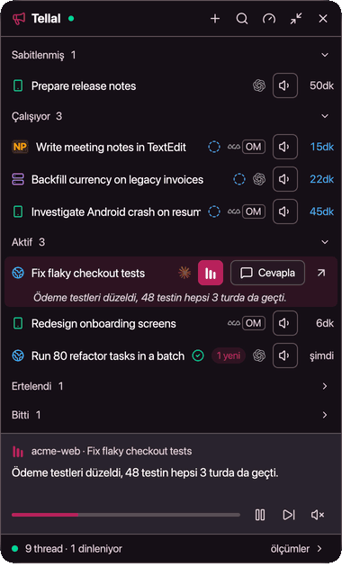
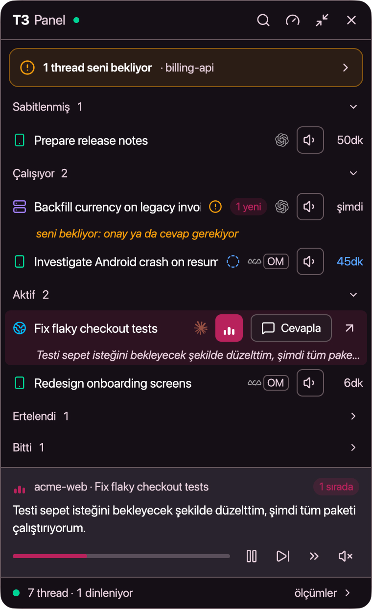
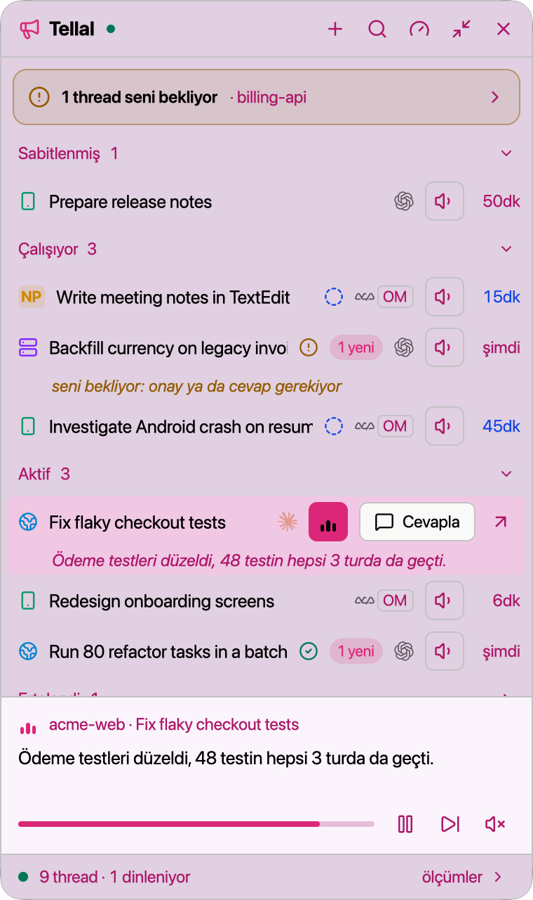
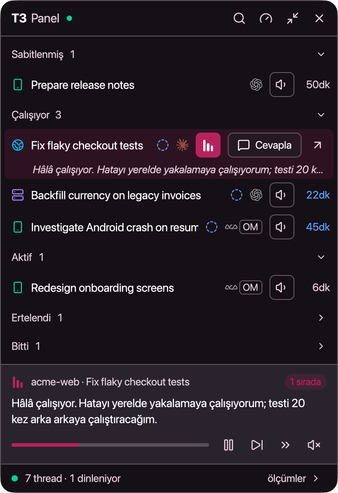
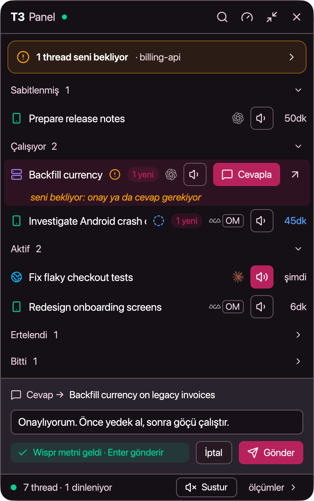
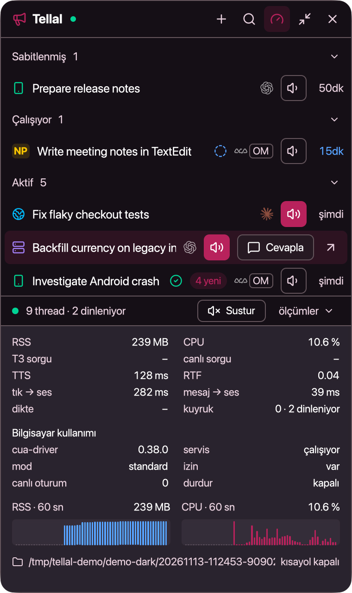
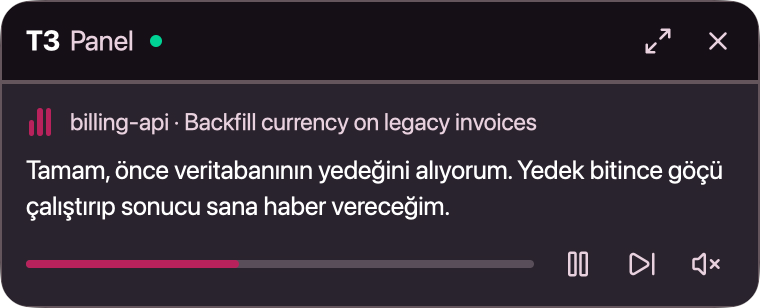

# t3-panel

A small always-on-top macOS panel that lists your [T3 Code](https://github.com/pingdotgg/t3code) agent threads and reads them aloud with a local voice, so you can follow several agents without watching them.



*Demo data only ([`demo/fixture.json`](demo/fixture.json)). The GIF is a silent 21 s excerpt. The voice is Turkish; captions are English. [Full video with sound](docs/media/demo.mp4) · [4:5 cut](docs/media/demo-social.mp4)*

| Dark | Light |
|---|---|
|  |  |

| Now playing | Reply dock | Metrics drawer | Compact |
|---|---|---|---|
|  |  |  |  |

## Why

I run several coding agents at once. Switching windows to check on each one breaks focus; a voice that says "tests are running", then "11 of 12 pass, shall I fix the last one?" does not. So:

- **Voice first.** Turn a thread on like a radio channel and it tells you what the agent is doing, then a one- or two-sentence summary when it is done. Reply by voice without leaving what you are doing.
- **Agent narration is written for the ear.** The [`sesli`](skill/sesli/) skill makes agents write a short start line, one sentence per step and a `🔊` summary line.
- **Zero API cost, everything local.** The voice is an 8.6M-parameter model running on the CPU inside the app. No cloud TTS, no account, no per-use cost; the model is downloaded once.
- **Read-only towards T3.** The panel reads T3's CLI output and state; the only thing it writes is a reply you send.

## Features

- **Radio channels with video controls.** Each thread is a channel with a 🔈/🔊 listen toggle. One voice at a time, first come first served across channels. Pause mid-sentence (the queue keeps filling), skip ("okay, next"), jump to live, mute all.
- **Live narration.** Every new assistant message on a listened channel is spoken: its `🔊` line if it has one, otherwise its first sentence. "Waiting for your answer" and "Stopped" are announced too.
- **Catch-up.** Turning a channel on first reads one catch-up sentence (the last `🔊` line, else the last message's first sentence, else the status). Muted channels count unheard messages (`3 yeni`).
- **🔊 summaries.** The final message's `🔊` line is what you hear; the full written report stays in T3.
- **Attention card.** "N threads are waiting for you" at the top; click to jump to the next one.
- **Reply dock with Wispr Flow.** `Cevapla` (Reply) opens a dock, starts [Wispr Flow](https://wisprflow.ai) hands-free dictation and sends the text to the thread with `t3 thread send` (a busy thread gets it as its next turn). Typing works too.
- **Open in T3.** Double-click a row (or `↗`, ⌘O) to open the thread in the T3 desktop app through its `t3code://` deep link.
- **T3 theme sync.** Colours and font follow the theme selected in T3 (built-in, custom and environment themes, light/dark/system, T3's contrast setting), live, with a 200 ms cross-fade. Contrast floors (text ≥ 7:1, secondary ≥ 4.5:1) are enforced.
- **Stable, T3-parity list.** T3's sections (Pinned, Working, Active, Snoozed, Settled), T3's project icons and provider marks, T3's working timer. Activity never reorders rows.
- **Keyboard first.** ↑/↓, Space (listen), Enter/R (reply), ⌘O, P, →, L, M, ⌘K search, ⌘⇧C compact, Esc. Global ⌃⌥Space shows or hides the panel from any app.
- **Metrics drawer.** RSS, CPU (with 60 s sparklines), T3 poll cost, TTS time, RTF, click→audio, message→audio, dictation latency, queue length.
- **Full telemetry.** Every input and output is a line in `events.jsonl`; resource samples go to `metrics.jsonl`; every utterance is saved as WAV; `t3p-report` turns a run into p50/p95 tables and an HTML report.
- **Demo mode.** `T3P_DEMO=demo/fixture.json` runs the whole panel on scripted fake threads: no T3 threads, no Wispr. Only the T3 theme is read, and the fixture can turn that off.

The UI is in Turkish today (`Cevapla` = Reply, `seni bekliyor` = waiting for you, `sırada` = queued). Design spec and rationale: [`docs/DESIGN.md`](docs/DESIGN.md).

## How it works

```
 T3 Code desktop app                                 Wispr Flow (optional)
   ├─ t3 CLI ── thread list / thread send              └─ history DB (read-only)
   ├─ state DB (SQLite, read-only) ── changes, messages,          │
   │                                  waiting requests            │
   └─ theme (localStorage + app.asar, read-only)                  │
                 │                                                │
                 ▼                                                ▼
 t3-panel-core (Rust)
   poll every 5 s · live tail every 1 s · channels + FIFO queue · theme resolver · telemetry
                 │
                 ▼
   lexicon → normalizer-tr → EMA Lightning (ONNX Runtime, CPU, 48 kHz) → rodio
                 │
                 ▼
 t3-panel app: GPUI window in a non-activating NSPanel (always on top, every Space)
```

- **Two crates.** [`crates/core`](crates/core) (`t3-panel-core`) has no UI: T3 data, channels, voice, telemetry, behind a small API (`Core::threads()`, `channels()`, `set_listening`, `send_reply`, `theme()`, …). [`crates/app`](crates/app) is the GPUI panel.
- **Data.** Thread lists come from T3's official CLI. A single read-only `sqlite3 -readonly` query per tick finds which projects changed, so the CLI runs only for those; another per second fetches new finished assistant messages and waiting approvals/questions for listed threads.
- **Voice.** EMA Lightning's ONNX graphs, ported to Rust: Turkish normalization (numbers, times, abbreviations) → the model's alphabet → `text.onnx` → `sound.onnx` (4 steps) → `decoder.onnx`. A pronunciation lexicon respells common English tech words ("pull request", "deploy", "PR") for the Turkish voice. Synthesis runs just in time; the next utterance is prepared while the current one plays.
- **Window.** GPUI's `PopUp` window kind is a non-activating `NSPanel`: it floats above every app and Space without stealing focus, and takes the keyboard only for the reply dock or the global shortcut.

## Quick start

Requirements:

- macOS on Apple Silicon
- [T3 Code](https://github.com/pingdotgg/t3code) desktop app with its `t3` CLI (default `~/.t3/bin/t3`)
- Rust 1.92 or newer
- Optional: [Wispr Flow](https://wisprflow.ai) for voice replies

```bash
git clone https://github.com/cengizhankose/t3-panel
cd t3-panel
./scripts/fetch-models.sh            # EMA Lightning ONNX voice, ~34 MB → ~/Library/Application Support/t3-panel/models
cargo build --release --workspace
target/release/t3-panel
```

The panel appears top-right above every app. Click 🔈 on a thread to listen; ⌃⌥Space hides and shows it.

**Try it without T3** (no T3 threads or Wispr needed; the voice model is still required):

```bash
T3P_DEMO=demo/fixture.json target/release/t3-panel
```

The fixture has 7 threads in 3 projects (Claude, Codex, omp and Cursor; pinned, running, waiting, finished, snoozed, settled). Between about 6 s and 42 s after start they play a script: progress messages, status changes, a `🔊` summary and a request for approval. Turn a channel on to hear it. `Cevapla` fills in the fixture's dictation after ~2.5 s, and sending is only logged. The scripted agent answers ~1.5 s later and the thread completes. Opening in T3 is only logged too. Demo mode never runs the `t3` CLI, never reads T3's state DB or Wispr Flow and never opens a URL (`t3p-report` on a demo run shows 0 `t3` and 0 `sqlite3` calls). It still reads your T3 theme, read-only, unless the fixture sets `"theme": "default"`.

Write your own scenario by editing [`demo/fixture.json`](demo/fixture.json): `at_s` is seconds after start, and `en` is an optional English caption. Set `"theme": "default"` to use the built-in dark palette instead of your T3 theme. To check it headless: `T3P_DEMO=demo/fixture.json T3P_OUTPUT_VOLUME=0 target/release/t3p-bench --e2e`.

**Agent side.** Install the [`sesli`](skill/sesli/) skill in Claude Code, Codex or omp so agents write a start line, short step messages and a `🔊` summary. Replies sent from the panel start with `$sesli ` to keep it on.

## Configuration

All settings are environment variables.

| Variable | Default | Meaning |
|---|---|---|
| `T3P_DEMO` | — | Path to a demo fixture (e.g. `demo/fixture.json`). Threads, messages, status changes and replies come from the fixture; the T3 CLI, T3's state DB and Wispr's DB are never touched. The T3 theme is still read unless the fixture sets `"theme": "default"`. |
| `T3P_OUTPUT_VOLUME` | `1.0` | Playback volume, `0.0`–`1.0`. Synthesis, timing and WAV saving are unchanged (`0` = silent runs and recordings). |
| `T3P_T3_BIN` | `~/.t3/bin/t3` | T3 CLI |
| `T3P_PROJECTS` | discovered from T3's state DB | Project ids or paths to watch, comma-separated |
| `T3P_POLL_MS` | `5000` | Thread list poll interval |
| `T3P_LIVE_POLL_MS` | `1000` | Live tail interval (new messages and waiting requests of listed threads) |
| `T3P_MODEL_DIR` | `~/Library/Application Support/t3-panel/models/ema-lightning-onnx` | Voice model (`meta.json`, `text.onnx`, `sound.onnx`, `decoder.onnx`) |
| `T3P_TTS_THREADS` | `2` | ONNX Runtime threads for the voice |
| `T3P_LEXICON` | `~/Library/Application Support/t3-panel/lexicon.tsv` | Your pronunciation lexicon: `written<TAB>spoken` per line; a key ending in `*` also matches inflected forms. Overrides built-in entries. |
| `T3P_REPLY_PREFIX` | `$sesli ` | Prepended to every reply sent from the panel (empty disables) |
| `T3P_HOTKEY` | `ctrl+alt+space` | Global show/hide shortcut (`global-hotkey` syntax, e.g. `cmd+shift+KeyP`); `off` disables |
| `T3P_LOG_ROOT` | `~/Library/Logs/t3-panel` | Telemetry root |
| `T3P_SAVE_AUDIO` | `1` | Save every utterance as WAV (`0` disables) |
| `T3P_WISPR_DB` | `~/Library/Application Support/Wispr Flow/flow.sqlite` | Wispr Flow history (read-only) |
| `T3P_T3_APP` | newest `T3 Code (Nightly).app` / `T3 Code.app` in `/Applications` or `~/Applications` | T3 app bundle whose built-in theme palettes are read |
| `T3P_T3_APP_DATA` | `~/Library/Application Support/t3code-v2` | T3's Electron userData dir (selected theme; read-only) |
| `T3P_SELFTEST` | — | Scripted UI runs that log and exit: `1` (listen to the first finished thread, then quit), `reply:<thread_id>` (reply flow; `T3P_SELFTEST_STOP_AFTER_MS`, `T3P_SELFTEST_NOSEND=1`), `shots` (step through UI states; `T3P_SELFTEST_STEP_MS`), `demo` (timed walkthrough on demo data, used to record the demo media) |

## Telemetry

Each run writes to `~/Library/Logs/t3-panel/<YYYYMMDD-HHMMSS-pid>/` (`latest` points to the newest). Nothing leaves the machine.

- `events.jsonl`: one line per input or output, `{ts, run, seq, kind, dur_ms, ok, in, out, err}`. T3 calls (`t3.*`, with argv, duration, child CPU and RSS), live tail (`live.*`), channel actions (`channel.*`), speech (`speak.enqueue`, `tts.synth` with written / respelled / spoken text and RTF, `audio.play` with click→audio and message→audio), replies and dictation (`reply.*`, `wispr.history`), theme resolution (`theme.resolve`, contrast ratios) and every UI interaction (`ui.*`, with before/after state).
- `metrics.jsonl`: RSS, CPU, thread count, queue length and child CPU, once per second.
- `audio/<seq>.wav`: every spoken utterance.

```bash
target/release/t3p-report latest   # per-kind p50/p95/max, RSS/CPU, poll cost, latencies → report.json + report.html
target/release/t3p-bench           # voice: cold load, per-sentence synth ms and RTF, peak RSS
target/release/t3p-bench --corpus sentences.txt   # same, with your sentences (one per line)
target/release/t3p-bench --t3      # cost of listing every project, 3 rounds
target/release/t3p-bench --theme   # resolve the T3 theme once: ThemeView JSON, contrast table
target/release/t3p-bench --e2e     # headless end-to-end: list, listen, progress, pause/resume
```

## Numbers

Measured on an Apple M4 Pro (macOS 27, other apps open).

| What | Result |
|---|---|
| Voice selection | 21 open Turkish-capable models surveyed; [bake-off](research/tts/bakeoff.md) of 59 runs (engines × voices × settings) on 7 panel sentences, scored by Whisper read-back |
| Voice cold load | ~0.6 s |
| Synthesis | 30–250 ms per sentence, RTF ~0.04 |
| Memory (RSS) | ~150–200 MB while speaking (CoreML was ~700 MB; the CPU provider is used) |
| Click → first audio | ~250 ms (247 ms measured) |
| Idle CPU | ~1.7 % average over 60 s |
| Theme contrast (T3 Chat) | text/canvas 18.7:1 dark, 16.9:1 light; secondary and accent text ≥ 4.5:1 in both |

Most of the delay between an agent writing and you hearing it (4–6.5 s) is T3 finishing the message; synthesis is ~0.2 s. Details: [`research/`](research/), [`docs/DESIGN.md`](docs/DESIGN.md) §9.

## Limitations

- macOS only (AppKit `NSPanel`, Carbon hotkey, Apple Silicon ONNX Runtime build).
- One Turkish voice, and Turkish UI copy. English words in titles are read with Turkish rules unless the lexicon respells them.
- Reads T3 internals (state DB schema, `localStorage` keys, `app.asar` palettes) that can change in any T3 nightly. Failures are logged (`ok:false`) and the panel falls back where it can.
- Replies from the panel queue as the thread's next turn; they cannot interrupt a running turn (a T3 CLI limit).
- No screen reader support: GPUI exposes no accessibility tree.

## Docs

- [`docs/DESIGN.md`](docs/DESIGN.md): design spec, deviations, measurements and UI review.
- [`docs/JOURNEY.md`](docs/JOURNEY.md): how the project came together.
- [`docs/PLAN.md`](docs/PLAN.md): concerns, decisions and phases (Turkish).
- [`research/`](research/README.md): TTS research and the T3 sidebar study.
- [`tools/`](tools/README.md): how the demo video, GIF and screenshots are recorded (window-only capture, demo data only).
- [`README.tr.md`](README.tr.md): Türkçe README, with every detail of channels, data sources and theme sync.

## Credits

- [T3 Code](https://github.com/pingdotgg/t3code) by Ping: the app this panel listens to, and the source of its look, project icons and provider marks (MIT).
- [GPUI](https://github.com/zed-industries/zed) by Zed Industries: the UI framework (Apache-2.0).
- [EMA Lightning](https://huggingface.co/canberkkkkkk/ema-lightning) and its [ONNX export](https://huggingface.co/ozcancelik/ema-lightning-onnx): the Turkish voice (Apache-2.0).
- [normalizer-tr](https://github.com/erdemtuna/normalizer-tr): Turkish text normalization (Apache-2.0).
- [ONNX Runtime](https://github.com/microsoft/onnxruntime) via [`ort`](https://github.com/pykeio/ort): inference (MIT; MIT/Apache-2.0).
- [Lucide](https://lucide.dev): icons (ISC).
- [Wispr Flow](https://wisprflow.ai): dictation for replies.

Licences of everything bundled: [`THIRD_PARTY_NOTICES.md`](THIRD_PARTY_NOTICES.md).

Not affiliated with T3 / Ping Labs.

## License

[MIT](LICENSE) © 2026 Cengizhan Köse
