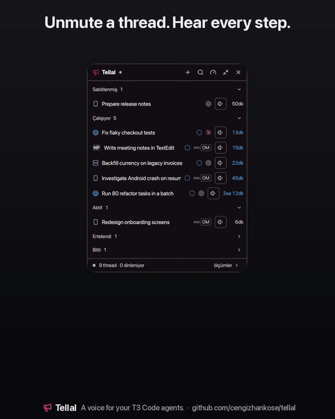
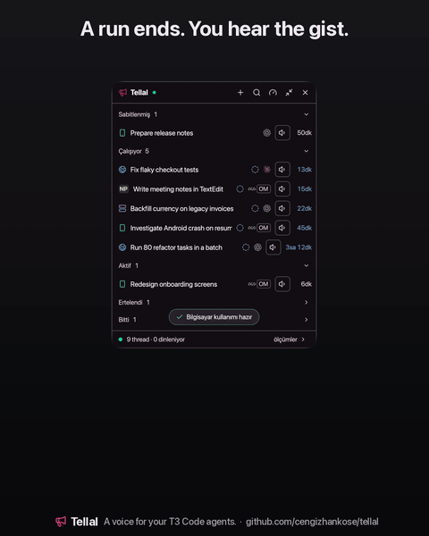
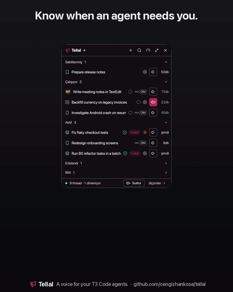
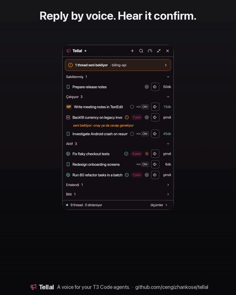
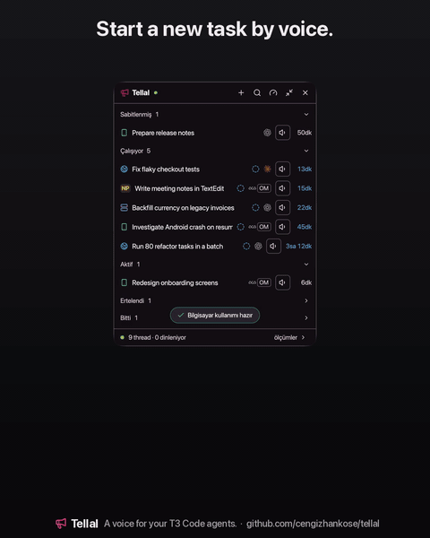
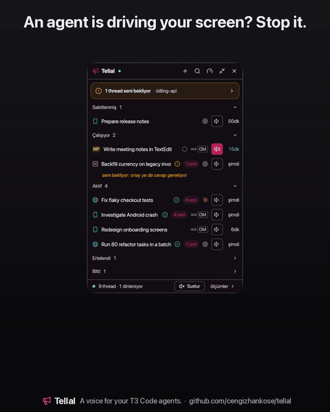
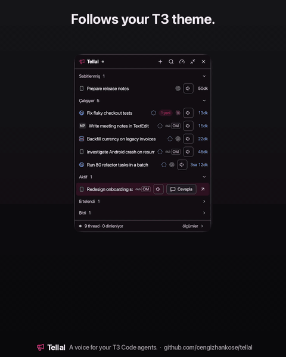

# Tellal

[English](README.md) · **Türkçe**

**A voice for your T3 Code agents.** — T3 Code ajanlarına bir ses.

Osmanlı'da *tellal*, sokak sokak dolaşıp haberleri yüksek sesle duyuran münadiydi (İngilizce okuyan "tell-all" da görür).

Tellal, her uygulamanın üstünde duran, [T3 Code](https://github.com/pingdotgg/t3code) thread'lerini listeleyen ve tıklanınca durumu lokal sesle, Türkçe ya da İngilizce okuyan panel. Rust + [GPUI](https://gpui.rs) (Zed'in UI framework'ü) + ONNX Runtime ([`ort`](https://crates.io/crates/ort)) üzerinde iki ses: [EMA Lightning](https://huggingface.co/canberkkkkkk/ema-lightning) (8,6M parametreli Türkçe ses modeli, Apache-2.0) ve [Supertonic 2](https://huggingface.co/Supertone/supertonic-2) (İngilizce, OpenRAIL-M). Ücretli API yok; her şey bu Mac'te çalışır.

## Ne yapar

Her klip, panelin demo verisiyle ([`demo/fixture.json`](demo/fixture.json)) çalışırken çekilmiş 6–20 sn'lik gerçek kaydı. Ses Türkçe; kliplerde İngilizce altyazı var. GIF'ler sessiz; bağlantılar sesli oynar.

| | |
|---|---|
|  | **Bir thread'i dinle.** Radyo kanalı gibi aç: önce tek yakalama cümlesi, sonra agent çalıştıkça her adım tek cümle. [▶ Sesli](docs/media/clips/listen.mp4) |
|  | **Sonucu duy.** İş bitince tek cümlelik 🔊 özetini duyarsın ("80 görevin 20'si takıldı, 30'u hata verdi… Hatalardan mı başlayalım?"); uzun rapor T3'te kalır. [▶ Sesli](docs/media/clips/summary.mp4) |
|  | **Agent seni beklediğinde bil.** Cevap ya da onay bekleyen thread dikkat kartını açar; tek tıkla oraya gidersin. [▶ Sesli](docs/media/clips/attention.mp4) |
|  | **Sesle cevap ver.** `Cevapla` [Wispr Flow](https://wisprflow.ai) dikteyi başlatır, `Gönder` metni `t3 thread send` ile thread'e iletir, agent'ın cevabı okunur. [▶ Sesli](docs/media/clips/reply.mp4) |
|  | **Sesle görev başlat.** `+` (ya da N), dikte et, `Gönder`: yeni bir T3 thread'i başlar (`t3 thread start`) ve panel onu zaten dinliyordur. [▶ Sesli](docs/media/clips/new-task.mp4) |
|  | **Bilgisayar kullanımını gör ve durdur.** Bir agent ekranı [cua-driver](https://github.com/trycua/cua) ile kullanırken bant bunu istemciyle ve en son ne zaman işlem yaptığıyla gösterir (cua-driver uygulama ya da işlem bildirmez); `Durdur` ya da her uygulamadan ⌃⌥⎋ tüm oturumları keser. [▶ Sesli](docs/media/clips/computer.mp4) |
|  | **T3 gibi görünür.** Renkler ve yazı tipi T3'te seçili temayı açık ya da koyu, canlı izler. [▶ Sesli](docs/media/clips/theme.mp4) |

[Sesli tam gezinti (16:9)](docs/media/demo.mp4) · [Sosyal medya için 45 sn'lik kesit (4:5)](docs/media/tellal-social.mp4) · [Ekran görüntüleri](docs/media/). Yalnızca Apple Silicon Mac'te çalışır (aşağıda [Kurulum](#kurulum)).

## Kurulum

1. [Son sürümden](https://github.com/cengizhankose/tellal/releases/latest) `Tellal-0.4.0.dmg`'yi indir, **Tellal**'ı Uygulamalar klasörüne sürükle. Uygulama Developer ID ile imzalı ve Apple tarafından notarize edilmiş.
2. Aç. Tellal Dock ikonu olmayan, yüzen bir panel; global kısayol ⌃⌥Space onu gösterir/gizler.
3. İlk açılışta dilinin sesini (Türkçe 35 MB, İngilizce 96 MB) `~/Library/Application Support/tellal/models` altına indirir; ilerleme durum satırının üstündeki satırda görünür.

Gerekenler: Apple Silicon Mac, macOS 13.4 ya da üstü, `t3` CLI'ı ile [T3 Code](https://github.com/pingdotgg/t3code). İsteğe bağlı: sesle cevap için [Wispr Flow](https://wisprflow.ai), bilgisayar kullanımı için [cua-driver](https://github.com/trycua/cua).

### Kaynaktan derleme

Gerekenler: Apple Silicon Mac (macOS 13.4+), T3 Code masaüstü uygulaması ve `t3` CLI'ı, Rust 1.92+, isteğe bağlı Wispr Flow.

```bash
./scripts/fetch-models.sh [tr|en|all]   # sesler (varsayılan all: 35 MB + 96 MB) → ~/Library/Application Support/tellal/models; uygulama da kendisi indirebilir
cargo build --release --workspace
target/release/tellal
```

Bakımcılar için: `scripts/package-macos.sh <sürüm>` `Tellal.app`'i ve DMG'yi derler, imzalar, notarize eder ve damgalar (staple); gerekenler ve seçenekler betiğin başındaki açıklamada.

### Demo modu

T3'e, Wispr'a ya da gerçek veriye dokunmadan denemek için (ses modeli yine gerekir):

```bash
TELLAL_DEMO=demo/fixture.json target/release/tellal
```

Thread'ler, mesajlar, durum değişiklikleri ve cevaplar [`demo/fixture.json`](demo/fixture.json)'dan gelir (4 projede 9 thread; Claude, Codex, omp, Cursor). `t3` CLI çalıştırılmaz, T3'ün state DB'si ve Wispr'in DB'si okunmaz, hiçbir bağlantı açılmaz (`tellal-report`: 0 `t3`, 0 `sqlite3` çağrısı). T3 teması, fixture `"theme": "default"` (yerleşik koyu palet) demedikçe yine okunur. Senaryo başlangıçtan ~6–75 sn sonra oynar (`at_s` = başlangıçtan sonraki saniye, `en` = isteğe bağlı İngilizce altyazı): ara adım mesajları, durum değişiklikleri, `🔊` özetleri (biri 80 görevlik toplu iş), onay isteği. Cevapla ~2,5 sn sonra fixture'daki dikteyi doldurur, gönderim yalnızca loglanır; agent ~1,5 sn sonra cevap verir ve thread biter. T3'te açma da yalnızca loglanır. İsteğe bağlı `computer` bloğu cua-driver'ı taklit eder (kurulu mu, izinler, mod) ve bilgisayar kullanımı oturumlarını zamanlar (`{at_s, session, client, app, action, end}`; bir oturumun sonraki her satırı o andaki bir işlemdir). Hazır fixture gerçek cua-driver gibidir (istemci `omp`, uygulama ya da işlem etiketi yok): not yazan agent TextEdit'te çalışırken üç oturum açılır; izin verme ~1,5 sn sonra başarılı olur, durdurma bütün oturumları hemen bitirir. İsteğe bağlı `new_task` bloğu sesle başlatılan görevin oluşturacağı thread'dir (`dictation`, `title`, `project`, `provider`, `ack`, `steps[{after_s, text, en, status}]`). Başsız kontrol: `TELLAL_DEMO=demo/fixture.json TELLAL_OUTPUT_VOLUME=0 target/release/tellal-bench --e2e` (bilgisayar kullanımı ve yeni görev için `--computer`). README'deki klipler, demo videoları ve ekran görüntüleri yalnızca bu veriyle çekildi.

## Diller ve sesler

- **Arayüz dili:** Türkçe ya da İngilizce, `TELLAL_LANG=tr|en`; boşsa macOS'un tercih edilen dili (`tr` ile başlıyorsa Türkçe, değilse İngilizce). Görünen her metni ve panelin kendi okuduğu cümleleri (yakalama ve durum cümleleri) değiştirir. İngilizce metin T3'ün kendi bölüm adlarını (Pinned, Working, Active, Snoozed, Settled) ve zamanlarını (`now`, `5m`, `3h`, `2d`) kullanır.
- **Sesler:** ikisi birlikte kurulabilir:

  | Id | Dil | Model | Lisans | İndirme |
  |---|---|---|---|---|
  | `tr-ema-lightning` | Türkçe | [EMA Lightning](https://huggingface.co/canberkkkkkk/ema-lightning) ([ONNX dışa aktarımı](https://huggingface.co/ozcancelik/ema-lightning-onnx)) | [Apache-2.0](https://huggingface.co/ozcancelik/ema-lightning-onnx) | 35 MB |
  | `en-supertonic-2` | İngilizce | [Supertonic 2](https://huggingface.co/Supertone/supertonic-2), M1 sesi (int8 parçalar [sherpa-onnx](https://huggingface.co/csukuangfj2/sherpa-onnx-supertonic-tts-int8-2026-03-06)'ten) | [OpenRAIL-M](https://huggingface.co/Supertone/supertonic-2/blob/main/LICENSE) (kullanım kısıtları var, bkz. [`THIRD_PARTY_NOTICES.md`](THIRD_PARTY_NOTICES.md)) | 96 MB |

  Dosyalar sabitlenmiş Hugging Face sürümlerinden gelir, SHA-256 ile doğrulanır ve `TELLAL_MODELS_DIR`'e (varsayılan `~/Library/Application Support/tellal/models`) yerleşir.
- **Hangi ses konuşur:** `TELLAL_VOICE=auto` (varsayılan) sesi her cümlenin diline göre seçer; iki ses de kuruluysa Türkçe thread Türkçe, İngilizce thread İngilizce okunur. `tr` ya da `en` hep o sesi kullanır.
- **İndirme:** arayüz dilinin sesi ilk açılışta kendiliğinden iner. Panelin ihtiyaç duyduğu ses yüklü değilken, inerken ya da inemediğinde durum satırının üstündeki satır `Sesi indir`, ilerleme ya da `Tekrar dene` gösterir; `D` aynısını yapar. Ölçüm çekmecesindeki Sesler listesi her sesi durumuyla gösterir; diğer ses de oradan indirilebilir.
- **Agent skill'leri:** [`sesli`](skill/sesli/) (Türkçe, tetikleyici `$sesli`) ve [`aloud`](skill/aloud/) (İngilizce, tetikleyici `$aloud`) agent'lara kulak için yazmayı öğretir. Kurulum: [`skill/sesli/README.md`](skill/sesli/README.md), [`skill/aloud/README.md`](skill/aloud/README.md). Panelden gönderilen cevaplar skill açık kalsın diye `$sesli ` (Türkçe arayüz) ya da `$aloud ` (İngilizce arayüz) ile başlar (`TELLAL_REPLY_PREFIX`).

## Panel

Tasarım sözleşmesi ve gerekçeler: [`docs/DESIGN.md`](docs/DESIGN.md). Görünüm T3'ün kenar çubuğunu izler; renkler ve yazı tipi T3'te seçili temadan gelir (`Core::theme()`), tema değişince 200 ms'lik geçişle uygulanır.

- **Pencere:** `WindowKind::PopUp` (`NSPanel`, non-activating, seviye 101, tüm Space'ler), Accessory uygulama (Dock ikonu yok), arka plan `Blurred` + canvas %92. Yükseklik içeriğe göre 160–640 px; değişimler `normal` (200 ms), kompakt geçişi `slow` (320 ms). Başlıktan sürüklenir.
- **Başlık:** megafon işareti + T3 yazı stilinde kalın `Tellal`. Panel canlıyken yeşil nokta; değilse hap: `bağlanıyor`, `ses yükleniyor`, `ses yok`, `ses iniyor`, `hata`. Sağda ara (⌘K), ölçümler, kompakt (⌘⇧C), kapat.
- **Dikkat kartı:** en az bir thread seni bekliyorsa listenin üstünde `N thread seni bekliyor · projeler →`; tıklayınca sıradaki bekleyen satıra gider (bölümü açar, kaydırır, bir kez vurgular).
- **Liste (T3 düzeni):** Sabitlenmiş, Çalışıyor, Aktif, Ertelendi, Bitti bölümleri; son ikisi kapalı başlar, hepsi tıklayınca açılır/kapanır (oturum boyunca hatırlanır). Sıra `Core::threads()` sırasıdır, etkinlik satırı oynatmaz. Satır 36 px: proje işareti (T3 lucide ikonu ve rengi, ikon yoksa T3'ün iki harfli renkli kutusu, projesizse kesikli kare) · başlık · durum glifi (çalışıyor: kesikli halka + `16dk`/`1sa 9dk` sayacı; seni bekliyor: sarı `!`; görülmemiş bitiş: yeşil ✓; durduruldu: soluk ⏸; hiçbiri dönmez) · `N yeni` · provider işareti (14 px, %60; ACP kayıt işaretinde `OM`/`OF`) · dinle düğmesi (her zaman görünür; açıkken accent dolgu, konuşurken ekolayzır) · zaman (`şimdi`, `5dk`, `3sa`, `2g`). Fareyle üstüne gelince ya da seçiliyken zamanın yerine `Cevapla` ve `↗` (T3'te aç) gelir. Satıra **çift tık** thread'i T3'te açar. Dinlenen satırda o anki cümle, bekleyen satırda `seni bekliyor` ikinci satırda görünür.
- **Şimdi çalıyor:** bir kanal konuşurken / duraklatılmışken / sırası varken altta açılır: `proje · başlık`, cümle (2 satır), ilerleme çubuğu (`now_elapsed_ms / now_total_ms`, konuşurken 150 ms'de bir yenilenir), `N sırada`, ⏸/▶ (P), ⏭ okey geç (→), canlıya geç (L, sıra varsa), hepsini sustur (M).
- **Cevap kutusu (`Cevapla`):** v0.2 akışı aynen: açılınca panel key olur, Wispr Flow dikteyi başlatır, Wispr metni kutuya yapıştırır; 600 ms içinde kutu boşsa Wispr geçmişinden doldurulur. Dikte sürerken Gönder → dikte durur, metin gelince kendiliğinden gönderilir. Başarılıysa kutu kapanır, `✓ Gönderildi` bildirimi çıkar ve önceki uygulama öne alınır; hata kutuda kalır, metin korunur. Başka satırda Cevapla hedefi değiştirir. Yazma/IME, ⌘V, ⌘A, Enter, Esc.
- **Bilgisayar kullanımı (cua-driver):** bir agent ekranı yerel [cua-driver](https://github.com/trycua/cua) ile kullanırken (`ComputerView.sessions` boş değilken) listenin en üstünde, dikkat kartının da üstünde bant: işaretçi ikonu, `Ajan ekranını kullanıyor`, birden fazlaysa `N oturum`, istemci + son işlem zamanı (`omp · son işlem 2dk`, işlemden önce `omp · bağlı`; cua-driver uygulama ya da işlem bildirmez), geçen süre (dakika çözünürlüğünde, saniye saymaz) ve kırmızı `Durdur` → `computer_stop_all()` (tüm oturumları `revoke --all` ile keser) + `Ekran kontrolü durduruldu` bildirimi. Bant bir kez kısa girişle gelir, sonra durağandır (yanıp sönmez); kompakt modda da görünür. Oturum varken başlıkta kırmızı `ekran` etiketi. Kuruluysa ama izin yoksa ya da bilinmiyorsa durum satırının üstünde ince satır: `Bilgisayar kullanımı: izin gerekli · İzin ver` (I) → `computer_grant_permissions()`, ardından `macOS pencerelerini onayla: Erişilebilirlik ve Ekran Kaydı`; izin gelince satır kalkar, `Bilgisayar kullanımı hazır`. Kurulu değilse ana ekranda hiçbir şey yok; ölçüm çekmecesinde `Bilgisayar kullanımı` bölümü (sürüm ya da `kurulu değil`, servis, mod, izin, canlı oturum, durdurma kısayolu).
- **Yeni görev (sesle):** başlıkta `+` (ipucu `Yeni görev (N)`, tuş N) cevap kutusunu yeni görev kipinde açar: `→ Yeni görev · <proje>` (`TELLAL_TASK_PROJECT`, yoksa T3'ün `No project`'i), dikte `dictation_start(NEW_TASK)` ile cevaptaki gibi (Wispr eller serbest, odak/geri verme, yapıştırma/yazma, Gönder'den sonra kendiliğinden gönderme, Esc iptal). Gönder → `start_task(metin)`; `TaskStarted` başarılıysa `Görev başladı`, kutu kapanır, yeni thread listede görünür görünmez seçilir, bölümü açılır, kaydırılır ve bir kez vurgulanır (zaten dinleniyor). Hata kutuda kalır, metin korunur.
- **Ses satırı:** panelin ihtiyaç duyduğu ses (arayüz dilininki ya da `TELLAL_VOICE`'unki) hazır değilken durum satırının üstünde 32 px'lik satır: `Sesi indir (N MB)`, ilerleme çubuğu ve yüzde, ya da hata ve `Tekrar dene` (D).
- **Durum satırı ve ölçümler:** bağlantı noktası · `N thread · M dinleniyor` · (çalan yokken dinlenen varsa) Sustur · `ölçümler`. Çekmece: RSS, CPU, T3 sorgu, canlı sorgu, TTS, RTF, tık→ses, mesaj→ses, dikte, kuyruk; RSS ve CPU için 60 sn çubuk grafik; run klasörü (tıkla: Finder), global kısayol durumu ve Sesler listesi (her ses: durum, indir).
- **Durumlar:** yükleniyor (parıltısız 3 yer tutucu satır), boş (`Şu an açık thread yok`), arama sonucu yok, hata bandı (`Tekrar dene` mümkünse, `Kayıtları aç`, kapat).
- **Kompakt:** ⤡ ya da ⌘⇧C ile yalnız başlık + Şimdi çalıyor.
- **Klavye** (panel key iken): ↑/↓ seçim · Space seçili satırı dinle/sustur (seçim yoksa oynatıcıyı duraklat) · Enter/R cevapla · N yeni görev · ⌘O T3'te aç · P duraklat · → geç · L canlıya geç · M hepsini sustur · ⌘K ara (Esc temizler) · ⌘⇧C kompakt · ⌘. bilgisayar kullanımını durdur (yazarken de) · I bilgisayar kullanımı izni (satır görünürken) · D eksik sesi indir (ses satırı görünürken) · Esc sırayla kutu/arama/çekmece/seçim kapatır. Tek harfli kısayollar metin kutusu odaktayken çalışmaz.
- **Global kısayollar:** ⌃⌥Space paneli her uygulamadan gizler/gösterir (gösterirken klavyeyi alır ama uygulamayı öne getirmez); `TELLAL_HOTKEY` (`ctrl+alt+space` biçimi, `off` kapatır). ⌃⌥⎋ acil durdurma: her uygulamadan tüm bilgisayar kullanımı oturumlarını keser (macOS'ta boş, Erişilebilirlik izni gerektirmez; ⌘⌥⎋ Zorla Çık'ın yanında); `TELLAL_STOP_HOTKEY` (`off` kapatır), `ui.stop_hotkey` olarak loglanır.
- **Hareket:** belirteçler `fast` 120 / `normal` 200 / `slow` 320 / `spring` 240 ms. macOS "Hareketi azalt" açıksa hareketler kalkar, solmalar 120 ms'ye iner, ekolayzır yerine sabit hoparlör. Sürekli hareket yalnız ses çalarken (ekolayzır).
- **İkonlar:** `crates/app/assets/**` (Lucide 0.564.0 tam set, provider işaretleri, logo) derleme sırasında binary'ye gömülür (`build.rs`).
- Her etkileşim `ui.*` olarak `events.jsonl`'a yazılır (`ui.click`/`ui.key`/`ui.hotkey` {action, thread, before/after}, `ui.search`, `ui.theme` {renkler, kontrast oranları}, `ui.reduce_motion`, `ui.error_banner`, `ui.stop_hotkey`, `ui.computer_banner`, `ui.computer_permissions`, `ui.task_send`, `ui.task_started`, …).

## Ortam değişkenleri

| Değişken | Varsayılan | Anlamı |
|---|---|---|
| `TELLAL_DEMO` | — | Demo fixture yolu (ör. `demo/fixture.json`); yukarıdaki [Demo modu](#demo-modu) |
| `TELLAL_OUTPUT_VOLUME` | `1.0` | Çalma sesi, `0.0`–`1.0`. Sentez, zamanlama ve WAV kaydı değişmez (`0`: sessiz çalıştırma ve kayıt) |
| `TELLAL_T3_BIN` | `~/.t3/bin/t3` | T3 CLI |
| `TELLAL_PROJECTS` | T3 state DB'den keşif | İzlenecek proje id/yolları, virgülle |
| `TELLAL_POLL_MS` | `5000` | Sorgu aralığı |
| `TELLAL_LANG` | macOS'un tercih edilen dili (`tr*` → `tr`, değilse `en`) | Arayüz dili ve panelin kendi okuduğu cümleler: `tr` ya da `en` |
| `TELLAL_VOICE` | `auto` | Hangi ses konuşur: `auto` (her cümlede diline göre), `tr` ya da `en` |
| `TELLAL_MODELS_DIR` | `~/Library/Application Support/tellal/models` | Ses modelleri, ses başına bir klasör (`ema-lightning-onnx/`, `supertonic-2-en/`) |
| `TELLAL_TTS_THREADS` | `2` | Ses modelinin ONNX Runtime iş parçacığı sayısı |
| `TELLAL_LEXICON` | `~/Library/Application Support/tellal/lexicon.tsv` | Türkçe ses için kullanıcı telaffuz sözlüğü (aşağıya bakın) |
| `TELLAL_LEXICON_EN` | `~/Library/Application Support/tellal/lexicon-en.tsv` | Aynısı, İngilizce ses için |
| `TELLAL_LOG_ROOT` | `~/Library/Logs/tellal` | Telemetri kökü |
| `TELLAL_SAVE_AUDIO` | `1` | Her konuşmayı WAV olarak sakla (`0` kapatır) |
| `TELLAL_SELFTEST` | — | `1`: ilk bitmiş thread'i dinlemeye alır, ses bitince `mute_all` yapıp kapanır. `reply:<thread_id>`: o thread için Cevapla akışı, `TELLAL_SELFTEST_STOP_AFTER_MS` (varsayılan `8000`) sonra Gönder; `TELLAL_SELFTEST_NOSEND=1` ise göndermek yerine `ui.selftest_reply {text, source}` yazar; ReplySent'ten 3 sn sonra ya da 60 sn'de kapanır. `shots`: arayüz durumlarını sırayla gösterir (full, voice_downloading, voice_failed, voice_ready, permissions, selected, dock (Wispr'siz), drawer, computer, compact, empty_search, error, new_task (demo dikte, Wispr'siz)), her biri `ui.selftest_state {state, window_number}` yazar; ses durumları ses satırının indirmesini gezer (ses satırı çıkamıyorsa hemen atlanır); bilgisayar kullanımı durumları demo fixture'ın oturumlarını bekler (yoksa 45 sn sonra atlanır); adım süresi `TELLAL_SELFTEST_STEP_MS` (varsayılan `2500`); sonunda kapanır. `demo`: demo verisiyle zamanlı gezinti (demo videosu bununla çekilir; izin verme, bilgisayar kullanımı bandı ve bir kez `Durdur`, yeni görev dahil), `ui.selftest_state` / `ui.selftest_action` yazar. `clip:<ad>[:<thread>]`: README klipleri için demo verisiyle tek özellik (`listen`, `summary`, `attention`, `reply`, `new-task`, `computer`, `theme`; `<thread>` seçilecek ya da dinlenecek thread), aynı olayları yazar. `demo` ve `clip` fareyi yok sayar (pencere canlı panelin yerinde durur) |
| `TELLAL_HOTKEY` | `ctrl+alt+space` | Paneli her uygulamadan gizleyen/gösteren global kısayol (`global-hotkey` biçimi, ör. `cmd+shift+KeyP`); `off` kapatır; sonuç `ui.hotkey` olarak loglanır |
| `TELLAL_STOP_HOTKEY` | `ctrl+alt+escape` | Bilgisayar kullanımı acil durdurma kısayolu (⌃⌥⎋, her uygulamadan `cua-driver revoke --all`); aynı biçim; `off` kapatır; kayıt ve basışlar `ui.stop_hotkey` olarak loglanır |
| `TELLAL_LIVE_POLL_MS` | `1000` | Canlı takip aralığı (dinlenen kanalların yeni mesajları + bekleyen istekler) |
| `TELLAL_REPLY_PREFIX` | `$sesli ` (Türkçe arayüz) / `$aloud ` (İngilizce arayüz) | Tellal'dan gönderilen her cevabın başına eklenir (boş değer kapatır) |
| `TELLAL_CUA_DRIVER` | `/Applications/CuaDriver.app/Contents/MacOS/cua-driver` | Bilgisayar kullanımı için cua-driver ikilisi. Yoksa bilgisayar kullanımı kapalı. Panel daemon soketini izler (`~/Library/Caches/cua-driver/cua-driver.sock`: daemon çalışırken oturumlar 1 sn'de bir, yoksa 5 sn'de bir; izinler 60 sn'de bir) ve oturumları `cua-driver revoke --all` ile durdurur |
| `TELLAL_TASK_PROJECT` | T3'ün "No project"i (`~/.t3/scratch`) | Panelden başlatılan görevlerin T3 projesi, id ya da yol (`t3 thread start`, listedeki en yeni thread'in sağlayıcı/modeli) |
| `TELLAL_WISPR_DB` | `~/Library/Application Support/Wispr Flow/flow.sqlite` | Wispr Flow geçmişi (yalnızca okunur) |
| `TELLAL_T3_APP` | en yeni `T3 Code (Nightly).app` / `T3 Code.app` (`/Applications`, `~/Applications`) | Yerleşik tema paletlerinin okunduğu T3 masaüstü uygulaması |
| `TELLAL_T3_APP_DATA` | `~/Library/Application Support/t3code-v2` | T3 masaüstü uygulamasının Electron userData klasörü (seçili tema `Local Storage`'da; yalnızca okunur) |

## Kanallar

Her thread bir kanal. Radyo gibi: sessiz kanal okunmaz, gelen asistan mesajları yalnızca `unheard` sayacını artırır. Dinlemeye alınınca (`set_listening`) tek bir yakalama cümlesi okunur (son `🔊` satırı, yoksa son mesajın ilk cümlesi, yoksa durum), sonra her yeni asistan mesajı canlı okunur: `🔊` satırı varsa o, yoksa ilk cümle (en çok 160 karakter). Thread kullanıcıyı beklemeye geçerse "senden cevap bekliyor.", durdurulursa "Durduruldu." okunur.

Video gibi: aynı anda tek ses çalar; dinlenen, duraklatılmamış kanallar arasında geliş sırası (FIFO). Duraklatma (`toggle_pause`) cümlenin ortasında tutar, kuyruk dolmaya devam eder, bu arada başka kanallar konuşabilir; devam edilince tutulan ses ilk sıradadır. `skip` çalanı atar, `jump_to_live` çalanı ve birikmişi atar, `mute_all` her şeyi susturur. Kanal değişince veya 20 sn sessizlikten sonra başa thread başlığından kısa bir etiket eklenir (≤30 karakterse başlık, değilse ilk 4 kelime). Ses, çalınacağı an sentezlenir; bir sonraki utterance önceden hazırlanır, cihaz açılırken ilk cümle sentezlenir.

Cevap: `send_reply` metni `TELLAL_REPLY_PREFIX` ile `t3 thread send <id> - --json`'a stdin'den verir (meşgul thread'de sıradaki tur olur, hiçbir şey kesilmez). Göndermeden hemen önce kanal yakalama cümlesi olmadan dinlemeye geçer; yalnızca gönderimden sonra yazılan mesajlar okunur. Dikte: `dictation_start` `open -g wispr-flow://start-hands-free` çalıştırır ve Wispr'in History tablosunu 250 ms'de bir izler (başlangıçtan yeni ilk final satır → `DictationTranscript`; boş/iptal/5 dk → `DictationFailed`). `dictation_stop` / `dictation_cancel` `stop-hands-free` açar; iptal metni yok sayar.

`open_thread` `https://app.t3.codes/threads/<env>/<thread>` linkini `t3code://threads/<env>/<thread>`'e çevirip `open` eder; tarayıcı değil T3 masaüstü uygulaması açılır.

## İzleme

Her çalıştırma `~/Library/Logs/tellal/<YYYYMMDD-HHMMSS-pid>/` altına yazar; `latest` en yenisini gösterir.

- `events.jsonl`: her girdi/çıktı tek satır: `{ts, run, seq, kind, dur_ms, ok, in, out, err}`.
  - T3: `t3.discover`, `t3.changes`, `t3.list`, `t3.messages`, `t3.poll`; her alt süreç için argv, süre, stdout byte, çıkış kodu, child CPU ms, max RSS.
  - Canlı takip: `live.poll` (`threads`, `rows`, `new_msgs`, `waiting`, child CPU), `live.message` (`thread`, `message_id`, `created_at`, `rule`, `action`: `enqueued` | `unheard` | `before_listen` | `empty`, okunacak metin), `wait.detect`.
  - Kanallar: `channel.listen`, `channel.pause`, `channel.skip`, `channel.live`, `channel.mute_all`.
  - Konuşma: `speak.enqueue` (kaynak `catchup` | `live` | `wait` | `stopped`, metin), `tts.load` (adım adım yükleme ms'si, model MB, sözlük boyutu), `tts.synth` (yazılan metin, sözlükle değişen hali `respelled`, modelin okuduğu hali `spoken`, parça sayısı, ses ms, RTF), `audio.open`, `audio.close`, `audio.play` (utterance başına: `msg_to_audio_ms`, `click_to_audio_ms`, `paused_ms`, `skipped`/`dropped`, `label_spoken`, `prefetched`, wav).
  - Cevap ve dikte: `reply.dictation_start`, `reply.dictation_stop`, `reply.dictation_cancel` (argv, url), `wispr.history` (satır alanları, metin, `e2eLatency`, `latency_from_stop_ms`, `latency_from_start_ms`), `reply.send` (argv, önekli metin, çıkış kodu, stdout + JSON, `queued`), `task.start` (yeni görev: argv, metin, çıkış kodu, stdout JSON).
  - Bilgisayar kullanımı: `computer.poll` (yöntem, süre, child CPU), `computer.session_start`, `computer.action`, `computer.session_end`, `computer.stop` (iptal edilen oturumlar), `computer.permissions_grant`.
  - Durum ve arayüz: `state.change`, `thread.open` (`link`, `app_url`), `theme.resolve`, `ui.*`.
- `metrics.jsonl`: saniyede bir RSS, CPU, thread sayısı, kuyruk, child CPU toplamı.
- `audio/<seq>.wav`: okunan her utterance'ın kaydı (etiket dahil; `seq` = `speak.enqueue`).

```bash
target/release/tellal-report latest   # kind başına p50/p95/max, RSS/CPU, live.poll maliyeti, msg→ses, tıklama→ses, dikte gecikmesi, reply.send, kanal eylemleri + report.json + report.html
target/release/tellal-bench           # TTS: soğuk yükleme, cümle başına synth ms / RTF, tepe RSS (Türkçe ses); her cümle run klasörüne WAV
target/release/tellal-bench --voice en   # aynısı, İngilizce ses ve İngilizce agent cümleleriyle
target/release/tellal-bench --corpus cumleler.txt   # aynısı, kendi cümlelerinle (satır başına bir cümle)
target/release/tellal-bench --download [ID ...]   # sesleri (varsayılan hepsi) TELLAL_MODELS_DIR'e indirir, sağlamaları doğrular
target/release/tellal-bench --t3      # tüm projeleri 3 tur listeleme maliyeti
target/release/tellal-bench --theme   # T3 temasını bir kez çözer: ThemeView JSON'u, çözüm raporu, kontrast tablosu
target/release/tellal-bench --e2e     # başsız uçtan uca: satır dökümü + iki poll arasında sıra karşılaştırması, ilk bitmiş thread'i dinlemeye alır, yakalama cümlesini okurken 250 ms'de bir ilerleme (elapsed/total) yazar, ~1,2 sn'de 1,5 sn duraklatıp devam ettirir
target/release/tellal-bench --computer [--stop-on-session]   # başsız: her değişiklikte Core::computer() dökümü, 60 sn CPU%'si (demo: izin, yeni görev, hepsini durdur da)
```

## Veri kaynağı

- T3 bağlantısı şimdilik CLI'ı ve salt-okunur state DB'yi sorgulayarak çalışır; itmeli bir `t3 thread watch --json` [T3'e önerildi](https://github.com/pingdotgg/t3code/discussions/31947#discussioncomment-19752998).
- Thread'ler: `t3 thread list --json` (T3'ün resmi CLI'ı). Cevaplar: `t3 thread send <id> - --json`.
- Proje keşfi, değişiklik tespiti, mesajlar ve bekleyen istekler: `~/.t3/userdata/statev2.sqlite`, yalnızca `/usr/bin/sqlite3 -readonly` ile.
  - Her 5 sn'lik tikte tek sorgu (~10–25 ms, `t3.changes`) hangi projenin `updated_at`'i değiştiğini bulur; `t3 thread list` sadece onlar için çalışır. 120 sn'de bir tam liste. Aynı sorgu (`UNION ALL`) proje başlığı, ikonu (`projection_projects.project_icon_json`, ör. `{"kind":"lucide","name":"cooking-pot","color":"red"}`) ve sabitlenmesini (`pinned_at`), thread'lerin sabitlenmesini (`payload_json` → `$.pinnedAt`, `$.pinOrderKey`), erteleme bitişini (`$.snoozedUntil`) ve aktif run'ın başlangıcını (`orchestration_v2_projection_runs`, `$.startedAt`; T3'ün "Working 16m" sayacının başladığı an → `ThreadView.running_since`) de getirir.
  - Sıra (`Core::threads()`), T3 kenar çubuğu gibi ve kararlı: önce sabitlenmiş thread'ler (T3'ün `pinOrderKey` sırası), sonra aktifler, en sonda bitmiş (settled) ya da ertelenmiş olanlar; her grupta en yeni `created_at` önce. Etkinlik (`updated_at`) sırayı hiç değiştirmez.
  - Canlı takip her saniye tek `sqlite3` çağrısı (~10–25 ms): listelenen thread'lerin `orchestration_v2_projection_messages` tablosundaki yeni, tamamlanmış (`streaming = 0`) asistan mesajları (thread başına `created_at` imleci, `(thread_id, created_at)` indeksi) + `orchestration_v2_projection_turn_items` içindeki `waiting` durumundaki `user_input_request` / `approval_request` / `secret_request` satırları. İmleç `Core::start` anında başlar; geçmiş tekrar okunmaz.
  - Yakalama cümlesi aynı DB'den thread'in son 12 mesajını okur (`t3.messages`, ~6 ms).
- Dikte metni: Wispr Flow `History` tablosu (`flow.sqlite`, yalnızca okunur; `timestamp` UTC metni `YYYY-MM-DD HH:MM:SS.mmm +00:00`).
- Bu tablolar T3'ün ve Wispr'in iç şeması; sürümle değişebilir. Değişiklik sorgusu hata verirse o tik her şeyi listeler ve `t3.changes ok:false` yazar; canlı takip hatası `live.poll ok:false` yazar.

## Tema senkronu

Panelin renkleri T3 Code masaüstü uygulamasında seçili temayı izler (`Core::theme()`, değişince `CoreEvent::ThemeChanged`). Her şey yalnızca okunur; T3'ün ayarlarına ve dosyalarına yazılmaz.

- **Seçim:** T3'ün `localStorage`'ı (`TELLAL_T3_APP_DATA/Local Storage/leveldb`, origin `t3code://app`): `t3code:theme` (tema id), `t3code:theme-appearance-mode` (`system` | `light` | `dark`), eski `t3code:theme-follow-system`, açık/koyu için ayrı tema seçimi `t3code:theme-halves:v1`, özel temalar `t3code:themes:v1`. LevelDB dosyaları (`.ldb` tablolar + `.log`) her biri tek `read` ile belleğe alınıp okunur (canlı veritabanı açılmaz/kilitlenmez); snappy blokları ve Chromium'un 1 bayt önekli Latin-1 / UTF-16 değerleri çözülür, her anahtarda en yüksek sıra numarası kazanır. IndexedDB okunmaz: T3'ün tema kodu temaları yalnızca `localStorage`'da tutuyor (paket incelendi).
- **Paletler:** yerleşik temalar (T3 Chat, Grove, Ocean, Ember, Iris) ve `system`/`light`/`dark` için nötr paletler çalışma anında kurulu uygulamanın `app.asar`'ından okunur: arşiv başlığı (JSON) ayrıştırılır, yalnızca web istemcisinin `themePalette-*.js` parçası okunur ve içindeki düz nesne literalleri (`{id, label, appearance, colors, variants}`) çıkarılır; T3 nightly güncellense de çalışır (arşiv mtime/boyutu değişince yeniden okunur). Ortam temaları `~/.t3/userdata/themes/*.json` (dosya adı = id; kısa biçimde `canvas` + `accent`'ten paleti T3'ün üreteci gibi türetir). Arama sırası T3'teki gibi: yerleşik → özel → ortam.
- **Görünüm:** `system` modunda macOS görünümü (`AppleInterfaceStyle`, CFPreferences). Çözüm kuralları T3'ün `useTheme` koduyla aynı (eski id'ler, tek görünümlü temalar kendi görünümünde kalır, açık/koyu ayrı seçimler önceliklidir).
- **Eşleme:** panel T3'ün kenar çubuğunu taklit ettiği için kenar çubuğu jetonları kullanılır: `canvas` = `sidebar`, `surface` = `surface`, `surface_hover` = `sidebarRowHover`, `border` = `sidebarBorder`, `text` = `sidebarForeground`, `text_muted` = `sidebarMutedForeground`, `accent` / `accent_text` = `accent` / `accentForeground`, `warning` / `danger` = `warning` / `error`; `success` / `info` T3'ün sabit Tailwind renkleri (emerald / blue, koyuda 400, açıkta 700). Yazı tipi: `client-settings.json` → `fontFamilySans` (boş = sistem), `fontSizeInterface`.
- **Kontrast:** önce T3'ün Görünüm → Kontrast ayarı (`appearanceContrast`, 50–200) T3'ün CSS'i gibi uygulanır (metin beyaza/siyaha, kenarlık ön plana doğru; ikincil metin hiyerarşi için palet değerinde kalır). Sonra OKLCH açıklığı kaydırılarak tabanlar sağlanır: `text` ≥ 7:1 (canvas/surface/hover), `text_muted` ≥ 4,5:1, `accent_text` ≥ 4,5:1 (accent üstünde), `accent` ≥ 3:1, durum renkleri ≥ 4,5:1 (canvas üstünde). Orijinal ve ayarlanmış değerler loglanır.
- **Yenileme:** 2 sn'de bir ucuz kontrol (leveldb ve tema klasörü dosyalarının boyut/mtime'ı, `client-settings.json`, `app.asar`, sistem görünümü). Bir şey değişirse girdiler yeniden okunur; yalnızca temayla ilgili girdiler değiştiyse yeniden çözülür, görünüm farklıysa `ThemeChanged` gönderilir. İlk çözüm `Core::start` içinde (~10–15 ms), ilk karede gerçek renkler var.
- **Telemetri:** `theme.resolve` `{in: {method: startup|refresh, changed}, out: {source, name, dark, colours, font, contrast: [{fg, bg, ratio, required}], original, after_contrast_setting, adjusted: [{token, from, to, ratio_from, ratio_to}], selection: {stored_theme, appearance_mode, halves, resolved, applied, origin, ...}, bundle, settings, system_dark, sources}, dur_ms}`. Okunamayan girdide `ok:false`, `err` = neden; görünüm `ThemeView::default()` (`source:"default"`) + T3'ün yazı tipi olur.
- `source`: `t3:<id>` (yerleşik/özel tema ya da `t3:system`), `t3-env:<id>` (ortam teması) veya `default`.

## Agent tarafı

[`sesli`](skill/sesli/SKILL.md) skill'i (Türkçe, `$sesli`; [kurulum](skill/sesli/README.md): `~/.claude/skills`, `~/.codex/skills`, `~/.omp/agent/skills` ya da `~/.agents/skills`): işe başlarken tek cümle, ara adımlar tek cümle, son mesaj `🔊` (okunacak) ve `👀` (okunmaz, ekranda bakılacak) satırlarıyla biter. Panel önce `🔊` satırını okur. İngilizce karşılığı [`aloud`](skill/aloud/SKILL.md) (`$aloud`; [kurulum](skill/aloud/README.md)): aynı kurallar, İngilizce ses için.

## Ses

- Motor: EMA Lightning ONNX grafikleri ([`ozcancelik/ema-lightning-onnx`](https://huggingface.co/ozcancelik/ema-lightning-onnx), Apache-2.0) `crates/core/src/ema.rs` içinde Rust'a taşındı: [`normalizer-tr`](https://crates.io/crates/normalizer-tr) (rakam, saat, yüzde, kısaltma) → modelin alfabesi → ≤10 sn'lik parçalar → `text.onnx` → kare planı → `sound.onnx` (4 adım) → `decoder.onnx`. 48 kHz, sonunda 15 ms sönümleme (çıtırtıya karşı).
- Telaffuz sözlüğü (`crates/core/src/lexicon.rs`): model İngilizce kelimeleri Türkçe kurallarla okur ("build" → "bu il"). Sık geçen teknik kelimeler normalleştiriciden önce yeniden yazılır ("pull request" → "pul rikuest", "PR'ı" → "pi ar'ı", "T3" → "ti tri"). Yalnızca okunan metin değişir. Kendi eklemelerin `TELLAL_LEXICON` dosyasına, satır başına `yazılan<TAB>okunan`; `*` ile biten anahtar çekimli halleri de yakalar (`push*` → "pushladım" = "puşladım"). Dosya yerleşik girdileri ezer; panel yeniden açılınca okunur.
- Ölçüm (M4 Pro, 7 panel cümlesi): soğuk yükleme ~0,6 sn, cümle başına 30–250 ms (RTF ~0,04), tepe RSS ~140–200 MB, tıklama→ses 247 ms. Whisper geri okumasında rakamlar, "pull request", "deploy", "iOS", "Durduruldu" doğru. Ayrıntı: [`research/tts/`](research/tts/README.md).
- İngilizce ses: Supertonic 2, M1 sesi (`crates/core/src/supertonic.rs`, `crates/core/src/english.rs`): İngilizce normalleştirme (URL, hash ve yollar okunmaz; saat, tarih, para, yüzde, sürüm, birimli sayılar yazıyla) → karakterler (`unicode_indexer.json`) → süre tahmini → metin kodlayıcı → 8 adım `vector_estimator` → `vocoder`; 44,1 kHz. Kendi sözlüğü `TELLAL_LEXICON_EN`. Araştırma: [`research/tts/english.md`](research/tts/english.md).
- Sınır: her dilde tek ses (Türkçe kadın, İngilizce erkek M1). Bir sesin okuduğu öbür dildeki kelimeler o sesin kurallarıyla okunur, sözlük yeniden yazmadıkça; `TELLAL_VOICE=auto` ve iki ses kuruluysa her cümle kendi dilinin sesini alır.

## Kararlar

- Ses için `ort` `AutoDevicePolicy::PreferCPU`: `ort`'un varsayılanı macOS'ta CoreML'i devreye sokuyor; CoreML ile bellek ~700 MB'a, açılış 2,5 sn'ye çıkıyordu. CPU ile ~150 MB ve 0,6 sn, hız neredeyse aynı.
- sherpa-onnx ve Piper kaldırıldı (eski model klasörü `models/vits-piper-tr_TR-dfki-medium` artık kullanılmıyor, silinebilir).
- `gpui` `runtime_shaders`: derleme Xcode'un ayrıca indirilen Metal Toolchain'ine (`xcrun metal`) ihtiyaç duymasın diye shader'lar açılışta derleniyor (açılış ~110 ms).

## Belgeler ve lisans

- [`docs/DESIGN.md`](docs/DESIGN.md) tasarım sözleşmesi, [`docs/PLAN.md`](docs/PLAN.md) kararlar ve fazlar, [`docs/JOURNEY.md`](docs/JOURNEY.md) projenin hikâyesi, [`research/`](research/README.md) ses ve arayüz araştırması, [`tools/`](tools/README.md) demo medyasının kaydı.
- Lisans: [MIT](LICENSE). Üçüncü taraf lisansları: [`THIRD_PARTY_NOTICES.md`](THIRD_PARTY_NOTICES.md).
- T3 / Ping Labs ile bağlantısı yoktur.
